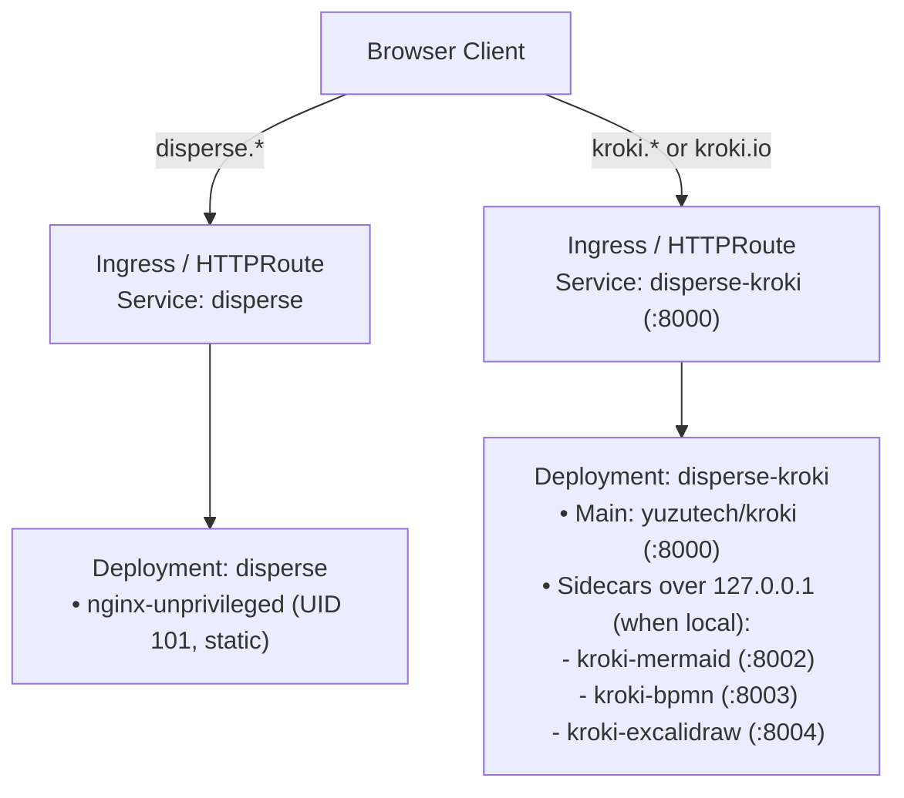

# DISPERSE

**Disperse** is a minimalist, icon-first single-page web application (**SPA**) for creating, editing, and sharing **Diagrams as Code**, powered by [Kroki](https://kroki.io) and featuring embedded interactive **Excalidraw** and **BPMN 2.0** visual editors.


---

## Documentation Map (Diátaxis)

This documentation is organized according to the [Diátaxis](https://diataxis.fr/) framework so you can jump directly to what you need:

1. [**Tutorials** *(Learning-oriented)*](#1-tutorials)
   - [Tutorial 1: Run Disperse with Docker in 60 Seconds](#tutorial-1-run-disperse-with-docker-in-60-seconds)
   - [Tutorial 2: Deploy a Self-Hosted Disperse + Kroki Stack on Local k3s with Helm](#tutorial-2-deploy-a-self-hosted-disperse--kroki-stack-on-local-k3s-with-helm)
2. [**How-To Guides** *(Task-oriented)*](#2-how-to-guides)
   - [How to Configure Companion Sidecars (`local`, `remote`, `disabled`)](#how-to-configure-companion-sidecars-local-remote-disabled)
   - [How to Disable Specific Diagram Languages](#how-to-disable-specific-diagram-languages)
   - [How to Connect to an External or Custom Kroki Server](#how-to-connect-to-an-external-or-custom-kroki-server)
   - [How to Customize or Hide Footer Credits](#how-to-customize-or-hide-footer-credits)
   - [How to Expose Disperse and Kroki via Ingress or Gateway API (`HTTPRoute`)](#how-to-expose-disperse-and-kroki-via-ingress-or-gateway-api-httproute)
   - [How to Work with Local Files and Auto-Save](#how-to-work-with-local-files-and-auto-save)
3. [**Reference** *(Information-oriented)*](#3-reference)
   - [Published OCI Artifacts (`ghcr.io`)](#published-oci-artifacts-ghcr-io)
   - [12-Factor Environment Variables](#12-factor-environment-variables)
   - [Helm Chart Values (`charts/disperse`)](#helm-chart-values-chartsdisperse)
   - [Keyboard Shortcuts](#keyboard-shortcuts)
   - [Supported Diagram Engines & File Extensions](#supported-diagram-engines--file-extensions)
   - [Development Tasks (`Taskfile.yml`)](#development-tasks-taskfileyml)
4. [**Explanation** *(Understanding-oriented)*](#4-explanation)
   - [Architecture: Decoupled Static SPA & Dedicated Kroki Ingress/Gateway](#architecture-decoupled-static-spa--dedicated-kroki-ingressgateway)
   - [Privacy Model: Why `local`, `remote`, and `disabled` Modes Exist](#privacy-model-why-local-remote-and-disabled-modes-exist)
   - [Stateless URLs vs. Per-Language Local Workspace Persistence](#stateless-urls-vs-per-language-local-workspace-persistence)
   - [Tetradic OKLCH Color System & Dark Mode Adaptation](#tetradic-oklch-color-system--dark-mode-adaptation)

---

## 1. Tutorials

### Tutorial 1: Run Disperse with Docker in 60 Seconds

In this tutorial, you will start Disperse in a single unprivileged container, create a diagram, customize the visual theme, and export a shareable Markdown snippet.

#### Prerequisites
- `docker` (or `podman`) installed.

#### Step 1: Start the container
Run the official OCI image from GitHub Container Registry:

```bash
docker run --rm -p 8765:8765 ghcr.io/sleepinfinitydev/disperse:latest
```

You will see:
```text
Starting server at http://localhost:8765 ...
```

#### Step 2: Create and preview a diagram
1. Open **`http://localhost:8765`** in your browser.
2. Focus is automatically placed in the code editor on the left with a default **D2** diagram rendered on the right.
3. Replace the editor text with:
   ```d2
   direction: right
   User -> Disperse: Writes code
   Disperse -> Kroki: Renders SVG
   ```
   After `500ms`, the diagram preview updates automatically and the browser URL hash updates to `#d2/svg/...`.

#### Step 3: Try a visual WYSIWYG editor
1. Open the language dropdown in the top bar (currently showing `d2`).
2. Scroll to the bottom and select **`Excalidraw (Editor · Beta)`** or **`BPMN (Editor · Beta)`**.
3. The left code panel collapses automatically to give you a full-width interactive canvas. Press **`Alt + 2`** at any time to view the live-synchronized JSON/XML code alongside the canvas.

#### Step 4: Copy a shareable snippet
In the bottom publishing bar:
- Click the **Markdown (`M↓`)** button on the first row (Image) or second row (Editor link), then click the **Copy** button on the right (or press **`Alt + I`** / **`Alt + E`**).

---

### Tutorial 2: Deploy a Self-Hosted Disperse + Kroki Stack on Local k3s with Helm

In this tutorial, you will deploy Disperse along with a complete in-cluster **Kroki** rendering stack (including Mermaid, BPMN, and Excalidraw companion sidecars) onto a local **[K3s](https://k3s.io)** Kubernetes cluster using the official Helm chart, exposing both services via [nip.io](https://nip.io) wildcard DNS (`http://disperse.127.0.0.1.nip.io` and `http://kroki.127.0.0.1.nip.io`).

#### Prerequisites
- A running **[K3s](https://k3s.io)** cluster (single-node local setup is sufficient).
- `helm` v3 and `kubectl` installed.

#### Step 1: Point Helm and `kubectl` to your k3s cluster
By default, [K3s cluster access](https://docs.k3s.io/cluster-access) uses `/etc/rancher/k3s/k3s.yaml`. Export `KUBECONFIG` so both `kubectl` and `helm` communicate with your local k3s cluster:

```bash
export KUBECONFIG=/etc/rancher/k3s/k3s.yaml
kubectl get nodes
```

*(Tip: If `/etc/rancher/k3s/k3s.yaml` is only readable by root, copy it to `~/.kube/config` and `chown $(id -u):$(id -g) ~/.kube/config`.)*

#### Step 2: Create `values-k3s.yaml`
Create a concise `values-k3s.yaml` enabling the self-hosted Kroki backend and dedicated k3s Traefik `Ingress` resources for both Disperse (`disperse.127.0.0.1.nip.io`) and Kroki (`kroki.127.0.0.1.nip.io`):

```yaml
# values-k3s.yaml
kroki:
  enabled: true
  ingress:
    enabled: true
    hosts:
      - host: kroki.127.0.0.1.nip.io
        paths:
          - path: /
            pathType: Prefix

ingress:
  enabled: true
  hosts:
    - host: disperse.127.0.0.1.nip.io
      paths:
        - path: /
          pathType: Prefix
```

#### Step 3: Install the Helm chart from GitHub Container Registry
Install a release named `disperse` directly from the official OCI Helm chart in GitHub Container Registry (`oci://ghcr.io/sleepinfinitydev/charts/disperse`):

```bash
helm upgrade --install disperse oci://ghcr.io/sleepinfinitydev/charts/disperse \
  --namespace disperse \
  --create-namespace \
  -f values-k3s.yaml
```

> **Testing a branch / preview build (or local checkout)**:
> - To test a branch build published by CI before merging to `main` (for example `feat-helm-charts`), pass `--version 0.1.0-<branch>` (the chart automatically pulls the matching `<branch>-<sha>` container image):
>   ```bash
>   helm upgrade --install disperse oci://ghcr.io/sleepinfinitydev/charts/disperse \
>     --version 0.1.0-feat-helm-charts \
>     --namespace disperse \
>     --create-namespace \
>     -f values-k3s.yaml
>   ```
> - Or from a cloned repository checkout, replace `oci://ghcr.io/sleepinfinitydev/charts/disperse` with `./charts/disperse`.

What this deploys in your k3s cluster:
- **`Deployment/disperse` + `Service/disperse` + `Ingress/disperse`**: Serves the static Disperse SPA on `http://disperse.127.0.0.1.nip.io` (`nginxinc/nginx-unprivileged`, `UID 101`, `readOnlyRootFilesystem: true`), pre-configured with `KROKI_BASE_URL=http://kroki.127.0.0.1.nip.io`.
- **`Deployment/disperse-kroki` + `Service/disperse-kroki` + `Ingress/disperse-kroki`**: Runs `yuzutech/kroki` together with `kroki-mermaid`, `kroki-bpmn`, and `kroki-excalidraw` sidecar containers (`UID 1001`, `readOnlyRootFilesystem: true`) on `http://kroki.127.0.0.1.nip.io`.

#### Step 4: Verify the rollout and run the Helm test suite
Wait for both deployments to become ready:

```bash
kubectl -n disperse rollout status deployment/disperse
kubectl -n disperse rollout status deployment/disperse-kroki
kubectl -n disperse get pods,svc,ingress
```

Verify in-cluster service health using the chart's built-in test hook:

```bash
helm test disperse --namespace disperse
```

#### Step 5: Open Disperse in your browser
Open **`http://disperse.127.0.0.1.nip.io`** in your browser:
- All 28 diagram engines (including D2, Mermaid, PlantUML, C4, GraphViz, DBML, Excalidraw, and BPMN) render against your private in-cluster Kroki server at **`http://kroki.127.0.0.1.nip.io/...`**.

---

## 2. How-To Guides

### How to Configure Companion Sidecars (`local`, `remote`, `disabled`)

When running a self-hosted Kroki backend (`kroki.enabled: true`), the core `yuzutech/kroki` container renders 25 engines natively, while **Mermaid**, **BPMN**, and **Excalidraw** use companion headless-Chromium sidecar containers (`yuzutech/kroki-mermaid`, `yuzutech/kroki-bpmn`, `yuzutech/kroki-excalidraw`).

You can control each of these 3 companion engines **individually** using three modes:

| Mode | In-Cluster Sidecar | UI Indicator in `#engine-select` | Diagram Data Privacy |
| :--- | :--- | :--- | :--- |
| **`local`** *(default)* | Deploys `yuzutech/kroki-<engine>` sidecar in `Deployment/disperse-kroki` | Standard label (e.g., `mermaid`) | 100% private / in-cluster |
| **`remote`** | Not deployed (saves ~150–400 MB RAM per sidecar) | Appends **`🌐 (kroki.io)`**, highlights selector in warning color, and shows tooltip: `⚠️ External service (kroki.io, non-confidential)` | Sent to `KROKI_REMOTE_URL` (`kroki.io`) |
| **`disabled`** | Not deployed (saves RAM) | Hidden from menu (shared links show an explicit disabled notice) | 100% private (unavailable) |

#### In Helm (`charts/disperse`)
Configure `kroki.sidecars.<engine>.mode` independently for `mermaid`, `bpmn`, and `excalidraw`:

```yaml
# values-hybrid.yaml
# Keep Mermaid local in-cluster, omit BPMN & Excalidraw sidecars (use remote kroki.io with UI warning)
kroki:
  enabled: true
  sidecars:
    mermaid:
      mode: local
    bpmn:
      mode: remote
    excalidraw:
      mode: remote
```

```bash
helm upgrade --install disperse oci://ghcr.io/sleepinfinitydev/charts/disperse -n disperse -f values-hybrid.yaml
```

To save Chromium sidecar memory while guaranteeing **no diagram payload is ever sent to `kroki.io`**, set unused companion engines to `disabled`:

```yaml
# values-minimal-private.yaml
kroki:
  enabled: true
  sidecars:
    mermaid:
      mode: local
    bpmn:
      mode: disabled
    excalidraw:
      mode: disabled
```

*(Note: Disperse's static web interface currently loads client-side UI libraries and fonts from public CDNs in the browser; disabling or localizing Kroki engines guarantees diagram payloads stay on-premise, while full offline/air-gapped asset vendorization is planned separately.)*

#### In Docker (`docker run`)
Pass `ENGINE_MODE_MERMAID`, `ENGINE_MODE_BPMN`, and `ENGINE_MODE_EXCALIDRAW` (`local` | `remote` | `disabled`):

```bash
docker run --rm -p 8765:8765 \
  -e KROKI_BASE_URL="https://kroki.internal.example.com" \
  -e KROKI_REMOTE_URL="https://kroki.io" \
  -e ENGINE_MODE_MERMAID="local" \
  -e ENGINE_MODE_BPMN="remote" \
  -e ENGINE_MODE_EXCALIDRAW="disabled" \
  ghcr.io/sleepinfinitydev/disperse:latest
```

---

### How to Disable Specific Diagram Languages

If your organization standardizes on a subset of languages (for example, hiding `tikz`, `umlet`, and `bytefield`), you can disable any engine ID from the dropdown selector:

#### With Docker
```bash
docker run --rm -p 8765:8765 \
  -e KROKI_DISABLED_ENGINES="tikz,umlet,bytefield" \
  ghcr.io/sleepinfinitydev/disperse:latest
```

#### With Helm
```yaml
# values.yaml
disperse:
  disabledEngines:
    - tikz
    - umlet
    - bytefield
```
```bash
helm upgrade --install disperse oci://ghcr.io/sleepinfinitydev/charts/disperse -n disperse -f values.yaml
```

---

### How to Connect to an External or Custom Kroki Server

Because Disperse's frontend is completely decoupled from the rendering backend, switching between public `https://kroki.io` and any private Kroki server is a single configuration setting (`KROKI_BASE_URL` / `disperse.krokiBaseUrl`):

```bash
# Docker
docker run --rm -p 8765:8765 \
  -e KROKI_BASE_URL="https://kroki.example.com" \
  ghcr.io/sleepinfinitydev/disperse:latest
```

```yaml
# Helm (values.yaml — using an existing Kroki server without deploying another in this release)
kroki:
  enabled: false

disperse:
  krokiBaseUrl: "https://kroki.example.com"
```
```bash
helm upgrade --install disperse oci://ghcr.io/sleepinfinitydev/charts/disperse -n disperse -f values.yaml
```

---

### How to Customize or Hide Footer Credits

Disperse's bottom credit line is configurable at runtime via the `FOOTER_CREDITS` environment variable (supports plain text, `<a href="...">` links, and `<i data-lucide="..."></i>` vector icons).

#### Set custom organizational credits
```bash
# Docker
docker run --rm -p 8765:8765 \
  -e FOOTER_CREDITS='Internal Architecture Portal · <a href="https://intranet.example.com" target="_blank">Platform Engineering</a>' \
  ghcr.io/sleepinfinitydev/disperse:latest
```

```yaml
# Helm (values.yaml)
disperse:
  footerCredits: 'Internal Architecture Portal · <a href="https://intranet.example.com" target="_blank">Platform Engineering</a>'
```

#### Hide the footer credit line completely
Set `FOOTER_CREDITS` / `disperse.footerCredits` to an empty string (`""`):

```bash
# Docker
docker run --rm -p 8765:8765 -e FOOTER_CREDITS="" ghcr.io/sleepinfinitydev/disperse:latest
```

```yaml
# Helm (values.yaml)
disperse:
  footerCredits: ""
```

---

### How to Expose Disperse and Kroki via Ingress or Gateway API (`HTTPRoute`)

Complex diagrams produce long Base64-encoded GET URLs on the **Kroki** endpoint. While Kroki is pre-configured with `KROKI_MAX_URI_LENGTH=16384`, **make sure your Ingress or Gateway controller in front of Kroki also allows large request headers**.

#### Using Kubernetes `Ingress` (`ingress-nginx` example)
```yaml
# values-ingress.yaml
kroki:
  enabled: true
  ingress:
    enabled: true
    className: nginx
    annotations:
      nginx.ingress.kubernetes.io/large-client-header-buffers: "4 16k"
    hosts:
      - host: kroki.example.com
        paths:
          - path: /
            pathType: Prefix
    tls:
      - secretName: kroki-tls
        hosts:
          - kroki.example.com

ingress:
  enabled: true
  className: nginx
  hosts:
    - host: disperse.example.com
      paths:
        - path: /
          pathType: Prefix
  tls:
    - secretName: disperse-tls
      hosts:
        - disperse.example.com
```
```bash
helm upgrade --install disperse oci://ghcr.io/sleepinfinitydev/charts/disperse -n disperse -f values-ingress.yaml
```

*(Note: When `disperse.krokiBaseUrl` is left empty `""`, the chart automatically sets `KROKI_BASE_URL` to `https://kroki.example.com` based on `kroki.ingress`!)*

#### Using Kubernetes Gateway API (`HTTPRoute`)
```yaml
# values-gateway.yaml
kroki:
  enabled: true
  httpRoute:
    enabled: true
    https: true
    parentRefs:
      - name: main-gateway
        namespace: gateway-system
        sectionName: https
    hostnames:
      - kroki.example.com

httpRoute:
  enabled: true
  https: true
  parentRefs:
    - name: main-gateway
      namespace: gateway-system
      sectionName: https
  hostnames:
    - disperse.example.com
```
```bash
helm upgrade --install disperse oci://ghcr.io/sleepinfinitydev/charts/disperse -n disperse -f values-gateway.yaml
```

---

### How to Work with Local Files and Auto-Save

1. **Open or Drag-and-Drop**: Press **`Ctrl + O`** (or drag any diagram file onto the window). Disperse inspects the file extension and content (`.d2`, `.mmd`, `.puml`, `.dbml`, `.excalidraw`, `.bpmn`, `.dot`, `.vg.json`, `.vl.json`, etc.) and automatically switches to the matching diagram language.
2. **Save & Save As**: Press **`Ctrl + S`** to save changes back to disk (or download the source file in browsers without the File System Access API), or **`Ctrl + Shift + S`** for Save As.
3. **Live Auto-Save to Disk**: In Chromium-based browsers (Chrome, Edge, Brave), click the lightning bolt icon (`⚡`) in the bottom local-file row or press **`Alt + A`**. Every edit in the code editor or visual WYSIWYG canvas is automatically written back to the linked local file.

---

## 3. Reference

### Published OCI Artifacts (`ghcr.io`)

Both the container image and the Helm chart are published to GitHub Container Registry under distinct paths (`disperse` vs. `charts/disperse`):

| Artifact | OCI Registry Path | `main` Tags / Versions | Branch Preview Tags / Versions (e.g. `feat-helm-charts`) |
| :--- | :--- | :--- | :--- |
| **Container Image** | `ghcr.io/sleepinfinitydev/disperse` | `latest`, `<chart-version>`, `<git-short-sha>` | `<branch>`, `<branch>-<git-short-sha>` *(never `latest`)* |
| **Helm Chart (OCI)** | `oci://ghcr.io/sleepinfinitydev/charts/disperse` | `<chart-version>` *(e.g. `0.1.0`, `appVersion: <git-short-sha>`)* | `<chart-version>-<branch>` and `<chart-version>-<branch>.g<git-short-sha>` *(e.g. `0.1.0-feat-helm-charts`, `appVersion: <branch>-<git-short-sha>`)* |

---

### 12-Factor Environment Variables

| Variable | `window.DISPERSE_CONFIG` Key | Default | Description |
| :--- | :--- | :--- | :--- |
| `PORT` | *(Nginx unprivileged)* | `8765` | HTTP listening port inside the container (`UID 101`). |
| `KROKI_BASE_URL` | `krokiBaseUrl` | `https://kroki.io` | Primary Kroki API URL used by the browser (`fetch` and shareable image snippets). |
| `KROKI_REMOTE_URL` | `krokiRemoteUrl` | `https://kroki.io` | External fallback Kroki URL used by engines in `remote` mode when `KROKI_BASE_URL` differs. |
| `ENGINE_MODE_MERMAID` | `engineModes.mermaid` | `local` | Routing mode for Mermaid (`local` \| `remote` \| `disabled`). |
| `ENGINE_MODE_BPMN` | `engineModes.bpmn` | `local` | Routing mode for BPMN (`local` \| `remote` \| `disabled`). |
| `ENGINE_MODE_EXCALIDRAW` | `engineModes.excalidraw` | `local` | Routing mode for Excalidraw (`local` \| `remote` \| `disabled`). |
| `KROKI_DISABLED_ENGINES` | `disabledEngines` | `""` | Comma-separated list of engine IDs to hide from `#engine-select`. |
| `FOOTER_CREDITS` *(alias: `DISPERSE_FOOTER_CREDITS`)* | `footerCredits` | *(Standard credits)* | Custom footer HTML/text, or `""` to hide the footer credit bar. |

---

### Helm Chart Values (`charts/disperse`)

Chart metadata: `version: 0.1.0`, `appVersion: "latest"`.

| Value | Type | Default | Description |
| :--- | :--- | :--- | :--- |
| `replicaCount` | `int` | `1` | Number of Disperse frontend pods. |
| `image.registry` | `string` | `"ghcr.io"` | Disperse OCI image registry. |
| `image.repository` | `string` | `"sleepinfinitydev/disperse"` | Disperse OCI image repository. |
| `image.tag` | `string` | `""` (`"latest"`) | Image tag override (defaults to `.Chart.AppVersion`). |
| `disperse.krokiBaseUrl` | `string` | `""` | Overrides primary Kroki URL (`""` auto-derives from `kroki.ingress`, `kroki.httpRoute`, `http://localhost:8000`, or `https://kroki.io`). |
| `disperse.footerCredits` | `string\|null` | `null` | Custom footer HTML/text (`null` = default credits, `""` = hidden). |
| `disperse.disabledEngines` | `list` | `[]` | List of engine IDs to hide from `#engine-select`. |
| `service.type` | `string` | `"ClusterIP"` | Disperse Service type (`ClusterIP`, `NodePort`, `LoadBalancer`). |
| `service.port` | `int` | `8765` | Disperse Service port. |
| `ingress.enabled` | `bool` | `false` | Enables Kubernetes `Ingress` for Disperse (`disperse.127.0.0.1.nip.io`). |
| `httpRoute.enabled` | `bool` | `false` | Enables Gateway API `HTTPRoute` for Disperse. |
| `kroki.enabled` | `bool` | `false` | Deploys the self-hosted `yuzutech/kroki` Deployment and Service. |
| `kroki.service.port` | `int` | `8000` | Kroki Service port. |
| `kroki.ingress.enabled` | `bool` | `false` | Enables dedicated Kubernetes `Ingress` for Kroki (`kroki.127.0.0.1.nip.io`). |
| `kroki.httpRoute.enabled` | `bool` | `false` | Enables dedicated Gateway API `HTTPRoute` for Kroki. |
| `kroki.image.repository` | `string` | `"yuzutech/kroki"` | Kroki server image repository. |
| `kroki.image.tag` | `string` | `"0.33.0"` | Kroki server and default companion sidecar image tag. |
| `kroki.remoteFallbackUrl` | `string` | `"https://kroki.io"` | External URL used when a companion engine is set to `mode: "remote"`. |
| `kroki.maxUriLength` | `int` | `16384` | Sets `KROKI_MAX_URI_LENGTH` on the Kroki server. |
| `kroki.sidecars.shmSize` | `string` | `"256Mi"` | Shared `/dev/shm` memory limit for Chromium sidecar containers. |
| `kroki.sidecars.mermaid.mode` | `string` | `"local"` | Mermaid mode when `kroki.enabled=true` (`local` \| `remote` \| `disabled`). |
| `kroki.sidecars.bpmn.mode` | `string` | `"local"` | BPMN mode when `kroki.enabled=true` (`local` \| `remote` \| `disabled`). |
| `kroki.sidecars.excalidraw.mode` | `string` | `"local"` | Excalidraw mode when `kroki.enabled=true` (`local` \| `remote` \| `disabled`). |
| `pdb.enabled` | `bool` | `false` | Enables `PodDisruptionBudget` (`policy/v1`, defaults to `maxUnavailable: 1`). |
| `extraManifests` | `list` | `[]` | Arbitrary Kubernetes manifests rendered through Helm's `tpl` engine. |

---

### Keyboard Shortcuts

| Shortcut | Action |
| :--- | :--- |
| `Ctrl/Cmd + R` | Refresh diagram preview immediately |
| `Alt + R` | Toggle automatic preview rendering (`500ms` debounce) |
| `Alt + N` | New diagram / Reset active language to default example |
| `Ctrl/Cmd + O` | Open local file |
| `Ctrl/Cmd + S` | Save local file (or download source file) |
| `Ctrl/Cmd + Shift + S` | Save local file as... |
| `Alt + A` | Toggle local file auto-save |
| `Alt + T` | Toggle Light / Dark theme |
| `F11` | Toggle browser fullscreen |
| `Alt + V` | Toggle Vim keybindings in the code editor |
| `Alt + L` | Copy current page link to clipboard |
| `Alt + 1` | Maximize code editor panel (`100%`) |
| `Alt + 2` | Reset split to golden ratio (`38.2%` / `61.8%`) |
| `Alt + 3` | Maximize diagram preview panel (`100%`) |
| `Alt + Enter` | Maximize / Restore diagram preview (also collapses export rows) |
| `Alt + +` / `Alt + -` / `Alt + 0` | Zoom in / Zoom out / Fit diagram preview |
| `Alt + D` | Download rendered diagram (`.svg` or `.png`) |
| `Alt + Shift + +` / `-` / `0` | Increase / Decrease / Reset code editor font size |
| `Alt + I` / `Alt + E` | Copy Image snippet / Copy Editor snippet |
| `Alt + X` | Collapse / Restore bottom export section |

---

### Supported Diagram Engines & File Extensions

| Category | Engine ID | Label in UI | Default File Ext |
| :--- | :--- | :--- | :--- |
| **Featured** | `d2` | `d2` *(default)* | `.d2` |
| **Featured** | `mermaid` | `mermaid` | `.mmd`, `.mermaid` |
| **Featured** | `dbml` | `dbml` | `.dbml` |
| **Featured (C4)** | `c4plantuml-context`, `-container`, `-component`, `-dynamic`, `-deployment` | `c4plantuml (...)` | `.puml`, `.plantuml` |
| **Code Engines** | `actdiag`, `blockdiag`, `nwdiag`, `packetdiag`, `rackdiag`, `seqdiag` | `actdiag`, `blockdiag`, ... | `.txt` |
| **Code Engines** | `bytefield` | `bytefield` | `.clj`, `.edn` |
| **Code Engines** | `ditaa` | `ditaa` | `.ditaa` |
| **Code Engines** | `erd` | `erd` | `.erd` |
| **Code Engines** | `graphviz` | `graphviz` | `.dot`, `.gv` |
| **Code Engines** | `nomnoml` | `nomnoml` | `.nomnoml` |
| **Code Engines** | `pikchr` | `pikchr` | `.pikchr` |
| **Code Engines** | `plantuml` | `plantuml` | `.puml`, `.plantuml`, `.iuml` |
| **Code Engines** | `structurizr` | `structurizr` | `.dsl` |
| **Code Engines** | `svgbob` | `svgbob` | `.txt` |
| **Code Engines** | `symbolator` | `symbolator` | `.vhd`, `.vhdl`, `.v`, `.sv` |
| **Code Engines** | `tikz` | `tikz` | `.tex`, `.tikz` |
| **Code Engines** | `umlet` | `umlet` | `.uxf` |
| **Code Engines** | `vega` / `vegalite` | `vega` / `vegalite` | `.vg.json` / `.vl.json` |
| **Code Engines** | `wavedrom` | `wavedrom` | `.json` |
| **Code Engines** | `wireviz` | `wireviz` | `.yml`, `.yaml` |
| **Visual Editors (Beta)** | `excalidraw` | `Excalidraw (Editor · Beta)` | `.excalidraw` |
| **Visual Editors (Beta)** | `bpmn` | `BPMN (Editor · Beta)` | `.bpmn` |

---

### Development Tasks (`Taskfile.yml`)

```bash
# Run locally on http://localhost:8765 (supports 12-Factor env vars)
task run
ENGINE_MODE_EXCALIDRAW=remote KROKI_BASE_URL=http://localhost:8000 task run PORT=9000
FOOTER_CREDITS="" task run

# Build OCI image (auto-detects podman or docker, tags :<git-hash> and :latest)
task build

# Build and push OCI image to registry
task push
```

---

## 4. Explanation

### Architecture: Decoupled Static SPA & Dedicated Kroki Ingress/Gateway

Disperse and Kroki have fundamentally different runtime profiles: Disperse is an ultra-lightweight static HTML/CSS/JS SPA, whereas Kroki is a JVM/CLI + headless-Chromium rendering backend that expects requests at its root path (`/{engine}/{format}/{payload}`) and natively emits CORS headers (`Access-Control-Allow-Origin: *`).

Instead of coupling Disperse's Nginx container as a reverse proxy in front of Kroki, the Helm chart exposes **each service cleanly through its own Kubernetes `Service` and `Ingress` / Gateway API `HTTPRoute`**:



- **100% Controller-Agnostic**: Works out of the box on K3s (Traefik), `ingress-nginx`, Cilium, HAProxy, AWS ALB, and any Gateway API controller without vendor-specific regex path-rewrite annotations or CRDs.
- **Zero Extra Network Hops**: Diagram rendering requests go directly to `disperse-kroki` (or `kroki.io`), never traversing the frontend Nginx pod.
- **Pure 12-Factor & Restricted PodSecurity**: Both Deployments run non-root (`UID 101` and `UID 1001`) with `readOnlyRootFilesystem: true`, `allowPrivilegeEscalation: false`, and `capabilities.drop: ["ALL"]`, configured strictly via environment variables.

---

### Privacy Model: Why `local`, `remote`, and `disabled` Modes Exist

While `yuzutech/kroki` includes 25 diagram engines in a single container, **Mermaid**, **BPMN**, and **Excalidraw** rely on browser layout APIs (`SVGElement.getBBox()`) and run as companion headless-Chromium sidecar containers.

By default (`mode: "local"`), deploying Kroki via the Helm chart (`kroki.enabled: true`) launches all three sidecars inside the `disperse-kroki` Pod over `127.0.0.1` for complete on-premise data privacy. For smaller clusters that wish to conserve Chromium memory, Disperse's tri-state engine model (`local` | `remote` | `disabled`) makes the privacy trade-off **explicit and transparent to end users**:
- Setting an engine to **`remote`** omits its sidecar container in Kubernetes and routes that engine to `kroki.remoteFallbackUrl` (`https://kroki.io`), visibly marking it in `#engine-select` with **`🌐 (kroki.io)`**, `--color-tertiary` warning styling, and a **`⚠️ External service (kroki.io, non-confidential)`** tooltip.
- Setting an engine to **`disabled`** omits its sidecar container and removes the engine from `#engine-select` completely.

---

### Stateless URLs vs. Per-Language Local Workspace Persistence

Disperse combines two complementary state models:
1. **Stateless Kroki-Compatible URLs**: Every change compresses the diagram source using **Zlib deflate (level 9)** + **URL-safe Base64** into `#engine/format/payload`, making every URL self-contained.
2. **Per-Language `localStorage` Drafts**: Each of the 32 selectable entries in `#engine-select` saves its own independent draft (`disperse-draft:{engine}`) in the browser. Switching from D2 to Mermaid or Excalidraw switches cleanly to that language's workspace without syntax collisions. Opening someone else's shared `#hash` link displays their diagram immediately **without overwriting** your saved local draft unless you edit it.

---

### Tetradic OKLCH Color System & Dark Mode Adaptation

From a single user-selected preferred color (`#0080c0` by default), Disperse converts `sRGB → Oklab → OKLCH` in real time to compute a **30° double-complementary tetradic palette** ($H$, $H+30^\circ$, $H+180^\circ$, $H+210^\circ$). In Dark Mode, rendered SVG/PNG diagrams use `filter: invert(0.92) hue-rotate(180deg)` so black strokes and text become crisp and bright against dark surfaces while preserving the original semantic hues of colored diagram nodes.

---

## Acknowledgments

Built on the shoulders of giants: [Kroki](https://kroki.io) (MIT), [Excalidraw](https://excalidraw.com) (MIT), [bpmn.io / bpmn-js](https://bpmn.io) (bpmn.io License), [Ace Editor](https://ace.c9.io) (BSD-3-Clause), [Panzoom](https://github.com/timmywil/panzoom) (MIT), [Pako](https://github.com/nodeca/pako) (MIT/Zlib), [Lucide](https://lucide.dev) (ISC/MIT), and inspired by [Niolesk](https://niolesk.top) (MIT).

## License

Licensed under the [GNU General Public License v3.0 (GPLv3)](LICENSE).
