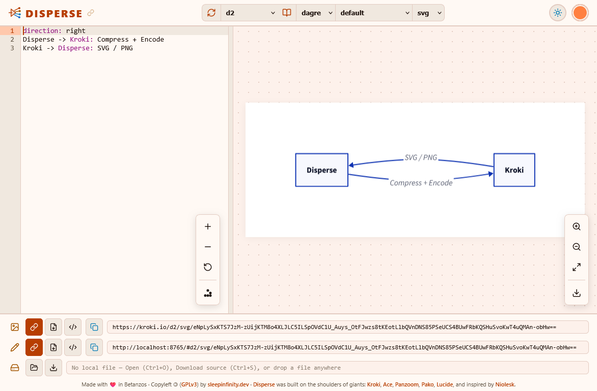

# DISPERSE

**Disperse** is a minimalist, icon-first single-page web application (**SPA**) for creating, editing, and sharing **Diagrams as Code**, powered by [Kroki](https://kroki.io) and featuring embedded interactive **Excalidraw** and **BPMN 2.0** visual editors.



---

## Documentation Map (Diátaxis)

This documentation is organized according to the [Diátaxis](https://diataxis.fr/) framework so you can jump directly to what you need:

1. [**Tutorials** *(Learning-oriented)*](#1-tutorials)
   - [Tutorial 1: Run Disperse with Docker in 60 Seconds](#tutorial-1-run-disperse-with-docker-in-60-seconds)
   - [Tutorial 2: Deploy a Self-Hosted Disperse + Kroki Stack on Local k3s with Helm](#tutorial-2-deploy-a-self-hosted-disperse--kroki-stack-on-local-k3s-with-helm)
2. [**How-To Guides** *(Task-oriented)*](#2-how-to-guides)
   - [How to Enable, Disable, or Route Engines (`local`, `remote`, `disabled`)](#how-to-enable-disable-or-route-engines-local-remote-disabled)
   - [How to Disable Specific Diagram Languages](#how-to-disable-specific-diagram-languages)
   - [How to Connect to an External or Custom Kroki Server](#how-to-connect-to-an-external-or-custom-kroki-server)
   - [How to Customize or Hide Footer Credits](#how-to-customize-or-hide-footer-credits)
   - [How to Expose Disperse via Ingress or Gateway API (`HTTPRoute`)](#how-to-expose-disperse-via-ingress-or-gateway-api-httproute)
   - [How to Work with Local Files and Auto-Save](#how-to-work-with-local-files-and-auto-save)
3. [**Reference** *(Information-oriented)*](#3-reference)
   - [12-Factor Environment Variables](#12-factor-environment-variables)
   - [Helm Chart Values (`charts/disperse`)](#helm-chart-values-chartsdisperse)
   - [Keyboard Shortcuts](#keyboard-shortcuts)
   - [Supported Diagram Engines & File Extensions](#supported-diagram-engines--file-extensions)
   - [Development Tasks (`Taskfile.yml`)](#development-tasks-taskfileyml)
4. [**Explanation** *(Understanding-oriented)*](#4-explanation)
   - [Architecture: Unified L7 Entrypoint & Dual Kubernetes Deployments](#architecture-unified-l7-entrypoint--dual-kubernetes-deployments)
   - [Privacy Model: Why `local`, `remote`, and `disabled` Modes Exist](#privacy-model-why-local-remote-and-disabled-modes-exist)
   - [Stateless URLs vs. Per-Language Local Workspace Persistence](#stateless-urls-vs-per-language-local-workspace-persistence)
   - [Tetradic OKLCH Color System & Dark Mode Adaptation](#tetradic-oklch-color-system--dark-mode-adaptation)

---

## 1. Tutorials

### Tutorial 1: Run Disperse with Docker in 60 Seconds

In this tutorial, you will start Disperse in a single container, create a diagram, customize the visual theme, and export a shareable Markdown snippet.

#### Prerequisites
- `docker` (or `podman`) installed.

#### Step 1: Start the container
Run the official OCI image from GitHub Container Registry:

```bash
docker run --rm -p 8765:8765 ghcr.io/sleepinfinitydev/disperse:latest
```

You will see:
```text
Starting server at http://localhost:8765 ...
```

#### Step 2: Create and preview a diagram
1. Open **`http://localhost:8765`** in your browser.
2. Focus is automatically placed in the code editor on the left with a default **D2** diagram rendered on the right.
3. Replace the editor text with:
   ```d2
   direction: right
   User -> Disperse: Writes code
   Disperse -> Kroki: Renders SVG
   ```
   After `500ms`, the diagram preview updates automatically and the browser URL hash updates to `#d2/svg/...`.

#### Step 3: Try a visual WYSIWYG editor
1. Open the language dropdown in the top bar (currently showing `d2`).
2. Scroll to the bottom and select **`Excalidraw (Editor · Beta)`** or **`BPMN (Editor · Beta)`**.
3. The left code panel collapses automatically to give you a full-width interactive canvas. Press **`Alt + 2`** at any time to view the live-synchronized JSON/XML code alongside the canvas.

#### Step 4: Copy a shareable snippet
In the bottom publishing bar:
- Click the **Markdown (`M↓`)** button on the first row (Image) or second row (Editor link), then click the **Copy** button on the right (or press **`Alt + I`** / **`Alt + E`**).

---

### Tutorial 2: Deploy a Self-Hosted Disperse + Kroki Stack on Local k3s with Helm

In this tutorial, you will deploy Disperse along with an in-cluster **Kroki** rendering backend onto a local **[K3s](https://k3s.io)** Kubernetes cluster using the official Helm chart included in this repository, exposing it on `http://disperse.127.0.0.1.nip.io` via [nip.io](https://nip.io) wildcard DNS.

#### Prerequisites
- A running **[K3s](https://k3s.io)** cluster (single-node local setup is sufficient).
- `helm` v3 and `kubectl` installed.

#### Step 1: Point Helm and `kubectl` to your k3s cluster
By default, [K3s cluster access](https://docs.k3s.io/cluster-access) uses `/etc/rancher/k3s/k3s.yaml`. Export `KUBECONFIG` so both `kubectl` and `helm` communicate with your local k3s cluster:

```bash
export KUBECONFIG=/etc/rancher/k3s/k3s.yaml
kubectl get nodes
```

*(Tip: If `/etc/rancher/k3s/k3s.yaml` is only readable by root, copy it to `~/.kube/config` and `chown $(id -u):$(id -g) ~/.kube/config`.)*

#### Step 2: Clone the repository and create a `values.yaml`
```bash
git clone https://github.com/sleepinfinitydev/disperse.git
cd disperse
```

Create a minimal `values-k3s.yaml` enabling the self-hosted Kroki backend and k3s's built-in Traefik `Ingress` on `disperse.127.0.0.1.nip.io` ([nip.io](https://nip.io) automatically resolves `*.127.0.0.1.nip.io` to `127.0.0.1` without editing `/etc/hosts` or conflicting with mDNS `.local` domains):

```yaml
# values-k3s.yaml
kroki:
  enabled: true

ingress:
  enabled: true
  hosts:
    - host: disperse.127.0.0.1.nip.io
      paths:
        - path: /
          pathType: Prefix
```

#### Step 3: Install the Helm chart
Install a release named `disperse` in a dedicated `disperse` namespace:

```bash
helm upgrade --install disperse ./charts/disperse \
  --namespace disperse \
  --create-namespace \
  -f values-k3s.yaml
```

What this deploys in your k3s cluster:
- **`Deployment/disperse`**: The Disperse frontend and Nginx L7 reverse proxy.
- **`Deployment/disperse-kroki`**: The self-hosted `yuzutech/kroki` server rendering the 25 core diagram engines locally inside your cluster.
- **`Service/disperse-kroki`**: An internal `ClusterIP` service (`:8000`) used by Disperse's Nginx to proxy `/kroki/*` requests.
- **`Service/disperse`**: The single published Kubernetes service (`:8765`) serving both `/` (the web app) and `/kroki/` (the rendering API).
- **`Ingress/disperse`**: Routes `http://disperse.127.0.0.1.nip.io/` through k3s's built-in Traefik Ingress controller to `Service/disperse`.

#### Step 4: Verify the rollout and run the Helm test suite
Wait for both deployments to become ready:

```bash
kubectl -n disperse rollout status deployment/disperse
kubectl -n disperse rollout status deployment/disperse-kroki
kubectl -n disperse get pods,svc,ingress
```

Verify end-to-end connectivity between the single service, Disperse, and the internal Kroki `/kroki/health` endpoint using the chart's built-in test hook:

```bash
helm test disperse --namespace disperse
```

#### Step 5: Open Disperse in your browser
Open **`http://disperse.127.0.0.1.nip.io`** in your browser *(or use `kubectl -n disperse port-forward svc/disperse 8765:8765` and visit `http://localhost:8765`)*:
- Notice in the bottom publishing bar that D2, PlantUML, C4, GraphViz, DBML, and all 25 core engines generate local URLs pointing to **`http://disperse.127.0.0.1.nip.io/kroki/...`**.
- Open the language menu: notice that `mermaid`, `Excalidraw`, and `BPMN` display **`🌐 (kroki.io)`** because they are configured in `remote` mode by default when sidecars are not deployed.

---

## 2. How-To Guides

### How to Enable, Disable, or Route Engines (`local`, `remote`, `disabled`)

When running a self-hosted Kroki backend (`kroki.enabled: true` or `KROKI_BASE_URL=/kroki`), the core `yuzutech/kroki` container renders 25 engines natively, while **Mermaid**, **BPMN**, and **Excalidraw** require separate companion services or an external fallback.

Disperse lets you control each of these 3 engines **individually** using three modes:

| Mode | Behavior | UI Indicator in `#engine-select` | Data Privacy |
| :--- | :--- | :--- | :--- |
| **`local`** | Routes requests to your primary `KROKI_BASE_URL` (e.g., `/kroki`). | Standard label (e.g., `mermaid`) | 100% private / in-cluster |
| **`remote`** | Routes requests from the browser to `KROKI_REMOTE_URL` (`https://kroki.io`). | Appends **`🌐 (kroki.io)`**, highlights selector in warning color, and shows tooltip: `⚠️ External service (kroki.io, non-confidential)` | Sent to external server (`kroki.io`) |
| **`disabled`** | Completely removes the engine from the UI selector and file auto-detection. | Hidden from menu | 100% private (unavailable) |

#### In Helm (`charts/disperse`)
Configure `kroki.sidecars.<engine>.mode` independently for `mermaid`, `bpmn`, and `excalidraw` in your `values.yaml`:

```yaml
# values-hybrid.yaml
# Disable Mermaid completely, keep Excalidraw & BPMN enabled via remote kroki.io with UI warning
kroki:
  enabled: true
  sidecars:
    mermaid:
      mode: disabled
    bpmn:
      mode: remote
    excalidraw:
      mode: remote
```

```bash
helm upgrade --install disperse ./charts/disperse -n disperse -f values-hybrid.yaml
```

For a **strict 100% on-premise / air-gapped environment** where no diagram may ever leave the cluster:

```yaml
# values-onprem.yaml
kroki:
  enabled: true
  sidecars:
    mermaid:
      mode: disabled
    bpmn:
      mode: disabled
    excalidraw:
      mode: disabled
```

```bash
helm upgrade --install disperse ./charts/disperse -n disperse -f values-onprem.yaml
```

#### In Docker (`docker run`)
Pass `ENGINE_MODE_MERMAID`, `ENGINE_MODE_BPMN`, and `ENGINE_MODE_EXCALIDRAW` (`local` | `remote` | `disabled`):

```bash
docker run --rm -p 8765:8765 \
  -e KROKI_BASE_URL="http://my-internal-kroki:8000" \
  -e KROKI_REMOTE_URL="https://kroki.io" \
  -e ENGINE_MODE_MERMAID="disabled" \
  -e ENGINE_MODE_BPMN="remote" \
  -e ENGINE_MODE_EXCALIDRAW="remote" \
  ghcr.io/sleepinfinitydev/disperse:latest
```

---

### How to Disable Specific Diagram Languages

If your organization standardizes on a subset of languages (for example, hiding `tikz`, `umlet`, and `bytefield`), you can disable any engine ID from the dropdown selector:

#### With Docker
```bash
docker run --rm -p 8765:8765 \
  -e KROKI_DISABLED_ENGINES="tikz,umlet,bytefield" \
  ghcr.io/sleepinfinitydev/disperse:latest
```

#### With Helm
```yaml
# values.yaml
disperse:
  disabledEngines:
    - tikz
    - umlet
    - bytefield
```
```bash
helm upgrade --install disperse ./charts/disperse -n disperse -f values.yaml
```

---

### How to Connect to an External or Custom Kroki Server

#### Option A: Direct Browser-to-Kroki Connection (CORS)
If you already run a Kroki server accessible from users' browsers (e.g., `https://kroki.example.com`):

```bash
# Docker
docker run --rm -p 8765:8765 \
  -e KROKI_BASE_URL="https://kroki.example.com" \
  ghcr.io/sleepinfinitydev/disperse:latest
```

```yaml
# Helm (values.yaml — without deploying a second Kroki in this release)
kroki:
  enabled: false

disperse:
  krokiBaseUrl: "https://kroki.example.com"
```
```bash
helm upgrade --install disperse ./charts/disperse -n disperse -f values.yaml
```

#### Option B: Reverse-Proxied via Disperse's Nginx (`/kroki`)
If your Kroki server is only reachable on an internal Docker network or Kubernetes cluster DNS and you want Disperse's Nginx to proxy `/kroki/*` to it:

```bash
docker run --rm -p 8765:8765 \
  -e KROKI_BASE_URL="/kroki" \
  -e KROKI_INTERNAL_UPSTREAM="http://kroki-container:8000" \
  ghcr.io/sleepinfinitydev/disperse:latest
```

---

### How to Customize or Hide Footer Credits

Disperse's bottom credit line is configurable at runtime via the `FOOTER_CREDITS` environment variable (supports plain text, `<a href="...">` links, and `<i data-lucide="..."></i>` vector icons).

#### Set custom organizational credits
```bash
# Docker
docker run --rm -p 8765:8765 \
  -e FOOTER_CREDITS='Internal Architecture Portal · <a href="https://intranet.example.com" target="_blank">Platform Engineering</a>' \
  ghcr.io/sleepinfinitydev/disperse:latest
```

```yaml
# Helm (values.yaml)
disperse:
  footerCredits: 'Internal Architecture Portal · <a href="https://intranet.example.com" target="_blank">Platform Engineering</a>'
```
```bash
helm upgrade --install disperse ./charts/disperse -n disperse -f values.yaml
```

#### Hide the footer credit line completely
Set `FOOTER_CREDITS` / `disperse.footerCredits` to an empty string (`""`):

```bash
# Docker
docker run --rm -p 8765:8765 -e FOOTER_CREDITS="" ghcr.io/sleepinfinitydev/disperse:latest
```

```yaml
# Helm (values.yaml)
disperse:
  footerCredits: ""
```
```bash
helm upgrade --install disperse ./charts/disperse -n disperse -f values.yaml
```

---

### How to Expose Disperse via Ingress or Gateway API (`HTTPRoute`)

Complex diagrams produce long Base64-encoded GET URLs. While Disperse's Nginx (`large_client_header_buffers 4 16k;`) and Kroki (`KROKI_MAX_URI_LENGTH=16384`) are pre-configured for large URIs, **make sure your external Ingress or Gateway controller also allows large request headers**.

#### Using Kubernetes `Ingress` (`ingress-nginx` example)
```yaml
# values-ingress.yaml
kroki:
  enabled: true

ingress:
  enabled: true
  className: nginx
  annotations:
    nginx.ingress.kubernetes.io/large-client-header-buffers: "4 16k"
  hosts:
    - host: disperse.example.com
      paths:
        - path: /
          pathType: Prefix
  # Reference an existing kubernetes.io/tls Secret in the same namespace (optional)
  tls:
    - secretName: disperse-tls
      hosts:
        - disperse.example.com
```
```bash
helm upgrade --install disperse ./charts/disperse -n disperse -f values-ingress.yaml
```

#### Using Kubernetes Gateway API (`HTTPRoute`)
```yaml
# values-gateway.yaml
kroki:
  enabled: true

httpRoute:
  enabled: true
  parentRefs:
    - name: main-gateway
      namespace: gateway-system
      sectionName: https
  hostnames:
    - disperse.example.com
```
```bash
helm upgrade --install disperse ./charts/disperse -n disperse -f values-gateway.yaml
```

---

### How to Work with Local Files and Auto-Save

1. **Open or Drag-and-Drop**: Press **`Ctrl + O`** (or drag any diagram file onto the window). Disperse inspects the file extension and content (`.d2`, `.mmd`, `.puml`, `.dbml`, `.excalidraw`, `.bpmn`, `.dot`, `.vg.json`, `.vl.json`, etc.) and automatically switches to the matching diagram language.
2. **Save & Save As**: Press **`Ctrl + S`** to save changes back to disk (or download the source file in browsers without the File System Access API), or **`Ctrl + Shift + S`** for Save As.
3. **Live Auto-Save to Disk**: In Chromium-based browsers (Chrome, Edge, Brave), click the lightning bolt icon (`⚡`) in the bottom local-file row or press **`Alt + A`**. Every edit in the code editor or visual WYSIWYG canvas is automatically written back to the linked local file.

---

## 3. Reference

### 12-Factor Environment Variables

| Variable | `window.DISPERSE_CONFIG` Key | Default | Description |
| :--- | :--- | :--- | :--- |
| `PORT` | *(Nginx / Server)* | `8765` | HTTP listening port inside the container (`80` is also always open). |
| `KROKI_BASE_URL` | `krokiBaseUrl` | `https://kroki.io` | Primary Kroki API URL (absolute URL or relative path like `/kroki`). |
| `KROKI_REMOTE_URL` | `krokiRemoteUrl` | `https://kroki.io` | External fallback Kroki URL used by engines in `remote` mode. |
| `KROKI_INTERNAL_UPSTREAM` | *(Nginx `/kroki/` proxy)* | `""` | Internal upstream URL (e.g., `http://disperse-kroki:8000`) for Nginx reverse proxy. |
| `ENGINE_MODE_MERMAID` | `engineModes.mermaid` | `local` | Routing mode for Mermaid (`local` \| `remote` \| `disabled`). |
| `ENGINE_MODE_BPMN` | `engineModes.bpmn` | `local` | Routing mode for BPMN (`local` \| `remote` \| `disabled`). |
| `ENGINE_MODE_EXCALIDRAW` | `engineModes.excalidraw` | `local` | Routing mode for Excalidraw (`local` \| `remote` \| `disabled`). |
| `KROKI_DISABLED_ENGINES` | `disabledEngines` | `""` | Comma-separated list of engine IDs to hide from `#engine-select`. |
| `FOOTER_CREDITS` | `footerCredits` | *(Standard credits)* | Custom footer HTML/text, or `""` to hide the footer credit bar. |
| `NGINX_CLIENT_MAX_BODY_SIZE` | *(Nginx)* | `2m` | Nginx `client_max_body_size` directive. |
| `NGINX_LARGE_CLIENT_HEADER_BUFFERS` | *(Nginx)* | `4 16k` | Nginx `large_client_header_buffers` directive for long diagram URLs. |
| `NGINX_PROXY_READ_TIMEOUT` | *(Nginx)* | `60s` | Nginx `proxy_read_timeout` for `/kroki/` upstream requests. |

---

### Helm Chart Values (`charts/disperse`)

Chart metadata: `version: 0.1.0`, `appVersion: "latest"`.

| Value | Type | Default | Description |
| :--- | :--- | :--- | :--- |
| `replicaCount` | `int` | `1` | Number of Disperse frontend pods. |
| `image.registry` | `string` | `"ghcr.io"` | Disperse OCI image registry. |
| `image.repository` | `string` | `"sleepinfinitydev/disperse"` | Disperse OCI image repository. |
| `image.tag` | `string` | `""` (`"latest"`) | Image tag override (defaults to `.Chart.AppVersion`). |
| `disperse.krokiBaseUrl` | `string` | `""` | Overrides primary Kroki URL (`""` auto-selects `/kroki` if `kroki.enabled=true`, else `https://kroki.io`). |
| `disperse.footerCredits` | `string\|null` | `null` | Custom footer HTML/text (`null` = default credits, `""` = hidden). |
| `disperse.disabledEngines` | `list` | `[]` | List of engine IDs to hide from `#engine-select`. |
| `service.type` | `string` | `"ClusterIP"` | Single published Kubernetes Service type (`ClusterIP`, `NodePort`, `LoadBalancer`). |
| `service.port` | `int` | `8765` | Published Service port. |
| `kroki.enabled` | `bool` | `false` | Deploys the self-hosted `yuzutech/kroki` Deployment and internal Service. |
| `kroki.image.repository` | `string` | `"yuzutech/kroki"` | Kroki server image repository. |
| `kroki.image.tag` | `string` | `"0.33.0"` | Kroki server image tag. |
| `kroki.remoteFallbackUrl` | `string` | `"https://kroki.io"` | External URL used when a companion engine is set to `mode: "remote"`. |
| `kroki.maxUriLength` | `int` | `16384` | Sets `KROKI_MAX_URI_LENGTH` on the Kroki server. |
| `kroki.sidecars.mermaid.mode` | `string` | `"remote"` | Mermaid mode when `kroki.enabled=true` (`remote` \| `disabled` \| `local`). |
| `kroki.sidecars.bpmn.mode` | `string` | `"remote"` | BPMN mode when `kroki.enabled=true` (`remote` \| `disabled` \| `local`). |
| `kroki.sidecars.excalidraw.mode` | `string` | `"remote"` | Excalidraw mode when `kroki.enabled=true` (`remote` \| `disabled` \| `local`). |
| `ingress.enabled` | `bool` | `false` | Enables Kubernetes `Ingress` (`networking.k8s.io/v1`). |
| `httpRoute.enabled` | `bool` | `false` | Enables Gateway API `HTTPRoute` (`gateway.networking.k8s.io/v1`). |
| `pdb.enabled` | `bool` | `false` | Enables `PodDisruptionBudget` (`policy/v1`). |
| `extraManifests` | `list` | `[]` | Arbitrary Kubernetes manifests rendered through Helm's `tpl` engine. |

---

### Keyboard Shortcuts

| Shortcut | Action |
| :--- | :--- |
| `Ctrl/Cmd + R` | Refresh diagram preview immediately |
| `Alt + R` | Toggle automatic preview rendering (`500ms` debounce) |
| `Alt + N` | New diagram / Reset active language to default example |
| `Ctrl/Cmd + O` | Open local file |
| `Ctrl/Cmd + S` | Save local file (or download source file) |
| `Ctrl/Cmd + Shift + S` | Save local file as... |
| `Alt + A` | Toggle local file auto-save |
| `Alt + T` | Toggle Light / Dark theme |
| `F11` | Toggle browser fullscreen |
| `Alt + V` | Toggle Vim keybindings in the code editor |
| `Alt + L` | Copy current page link to clipboard |
| `Alt + 1` | Maximize code editor panel (`100%`) |
| `Alt + 2` | Reset split to golden ratio (`38.2%` / `61.8%`) |
| `Alt + 3` | Maximize diagram preview panel (`100%`) |
| `Alt + Enter` | Maximize / Restore diagram preview (also collapses export rows) |
| `Alt + +` / `Alt + -` / `Alt + 0` | Zoom in / Zoom out / Fit diagram preview |
| `Alt + D` | Download rendered diagram (`.svg` or `.png`) |
| `Alt + Shift + +` / `-` / `0` | Increase / Decrease / Reset code editor font size |
| `Alt + I` / `Alt + E` | Copy Image snippet / Copy Editor snippet |
| `Alt + X` | Collapse / Restore bottom export section |

---

### Supported Diagram Engines & File Extensions

| Category | Engine ID | Label in UI | Default File Ext |
| :--- | :--- | :--- | :--- |
| **Featured** | `d2` | `d2` *(default)* | `.d2` |
| **Featured** | `mermaid` | `mermaid` | `.mmd`, `.mermaid` |
| **Featured** | `dbml` | `dbml` | `.dbml` |
| **Featured (C4)** | `c4plantuml-context`, `-container`, `-component`, `-dynamic`, `-deployment` | `c4plantuml (...)` | `.puml`, `.plantuml` |
| **Code Engines** | `actdiag`, `blockdiag`, `nwdiag`, `packetdiag`, `rackdiag`, `seqdiag` | `actdiag`, `blockdiag`, ... | `.txt` |
| **Code Engines** | `bytefield` | `bytefield` | `.clj`, `.edn` |
| **Code Engines** | `ditaa` | `ditaa` | `.ditaa` |
| **Code Engines** | `erd` | `erd` | `.erd` |
| **Code Engines** | `graphviz` | `graphviz` | `.dot`, `.gv` |
| **Code Engines** | `nomnoml` | `nomnoml` | `.nomnoml` |
| **Code Engines** | `pikchr` | `pikchr` | `.pikchr` |
| **Code Engines** | `plantuml` | `plantuml` | `.puml`, `.plantuml`, `.iuml` |
| **Code Engines** | `structurizr` | `structurizr` | `.dsl` |
| **Code Engines** | `svgbob` | `svgbob` | `.txt` |
| **Code Engines** | `symbolator` | `symbolator` | `.vhd`, `.vhdl`, `.v`, `.sv` |
| **Code Engines** | `tikz` | `tikz` | `.tex`, `.tikz` |
| **Code Engines** | `umlet` | `umlet` | `.uxf` |
| **Code Engines** | `vega` / `vegalite` | `vega` / `vegalite` | `.vg.json` / `.vl.json` |
| **Code Engines** | `wavedrom` | `wavedrom` | `.json` |
| **Code Engines** | `wireviz` | `wireviz` | `.yml`, `.yaml` |
| **Visual Editors (Beta)** | `excalidraw` | `Excalidraw (Editor · Beta)` | `.excalidraw` |
| **Visual Editors (Beta)** | `bpmn` | `BPMN (Editor · Beta)` | `.bpmn` |

---

### Development Tasks (`Taskfile.yml`)

```bash
# Run locally on http://localhost:8765 (supports 12-Factor env vars)
task run
ENGINE_MODE_EXCALIDRAW=remote KROKI_BASE_URL=/kroki task run PORT=9000

# Build OCI image (auto-detects podman or docker, tags :<git-hash> and :latest)
task build

# Build and push OCI image to registry
task push
```

---

## 4. Explanation

### Architecture: Unified L7 Entrypoint & Dual Kubernetes Deployments

A Kubernetes `v1/Service` operates at Layer 4 (TCP) and cannot route HTTP paths (`/` vs. `/kroki/`) or safely load-balance across heterogeneous Deployments. Furthermore, the upstream `yuzutech/kroki` server expects requests at the root path (`/{engine}/{format}/{payload}`).

Disperse solves this cleanly by using its own lightweight Nginx container as the **Unified Layer 7 Entrypoint**:

```text
External Traffic (Ingress / Gateway API HTTPRoute / port-forward)
       │
       ▼
┌─────────────────────────────────────────┐
│ Public Service: disperse (:8765)        │  <-- Single Published Service
└──────────────────┬──────────────────────┘
                   │
                   ▼
┌─────────────────────────────────────────┐
│ Deployment 1: disperse (Nginx SPA)      │
│  • /       -> Static SPA assets         │
│  • /kroki/ -> Rewrites & proxies ───────┼──► Internal Service: disperse-kroki (:8000)
└─────────────────────────────────────────┘                   │
                                                              ▼
                                              ┌───────────────────────────────┐
                                              │ Deployment 2: disperse-kroki  │
                                              │  • yuzutech/kroki (:8000)     │
                                              └───────────────────────────────┘
```

- **Controller-agnostic**: Works identically behind any Ingress controller, Gateway API implementation, `LoadBalancer`, `NodePort`, or `kubectl port-forward`.
- **Independent scaling & security**: The static SPA (`disperse`) and the JVM/CLI rendering engine (`disperse-kroki`) scale and roll out independently with isolated security contexts (`readOnlyRootFilesystem: true`, `runAsNonRoot: true`, `UID 1001`, `enableServiceLinks: false`).

---

### Privacy Model: Why `local`, `remote`, and `disabled` Modes Exist

While `yuzutech/kroki` includes 25 diagram engines in a single container, **Mermaid**, **BPMN**, and **Excalidraw** rely on browser layout APIs (`SVGElement.getBBox()`) and require headless Chromium sidecars for server-side static image rendering.

In many self-hosted Kubernetes environments, operators want to run the lightweight core Kroki server on-premise without immediately allocating extra RAM for Chromium sidecars—yet still want the option to use Excalidraw, BPMN, or Mermaid when needed.

Disperse's tri-state engine model (`local` | `remote` | `disabled`) makes this trade-off **explicit and transparent to end users**:
- Administrators can independently enable `excalidraw`, `bpmn`, or `mermaid` in **`remote`** mode even when using an internal Kroki server.
- Whenever an engine is in **`remote`** mode, Disperse visibly marks it in the language selector with **`🌐 (kroki.io)`**, highlights the selector in `--color-tertiary`, and displays a **`⚠️ External service (kroki.io, non-confidential)`** warning tooltip so users never inadvertently place confidential architecture data into an externally rendered diagram.

---

### Stateless URLs vs. Per-Language Local Workspace Persistence

Disperse combines two complementary state models:
1. **Stateless Kroki-Compatible URLs**: Every change compresses the diagram source using **Zlib deflate (level 9)** + **URL-safe Base64** into `#engine/format/payload`, making every URL self-contained.
2. **Per-Language `localStorage` Drafts**: Each of the 32 selectable entries in `#engine-select` saves its own independent draft (`disperse-draft:{engine}`) in the browser. Switching from D2 to Mermaid or Excalidraw switches cleanly to that language's workspace without syntax collisions. Opening someone else's shared `#hash` link displays their diagram immediately **without overwriting** your saved local draft unless you edit it.

---

### Tetradic OKLCH Color System & Dark Mode Adaptation

From a single user-selected preferred color (`#0080c0` by default), Disperse converts `sRGB → Oklab → OKLCH` in real time to compute a **30° double-complementary tetradic palette** ($H$, $H+30^\circ$, $H+180^\circ$, $H+210^\circ$). In Dark Mode, rendered SVG/PNG diagrams use `filter: invert(0.92) hue-rotate(180deg)` so black strokes and text become crisp and bright against dark surfaces while preserving the original semantic hues of colored diagram nodes.

---

## Acknowledgments

Built on the shoulders of giants: [Kroki](https://kroki.io) (MIT), [Excalidraw](https://excalidraw.com) (MIT), [bpmn.io / bpmn-js](https://bpmn.io) (bpmn.io License), [Ace Editor](https://ace.c9.io) (BSD-3-Clause), [Panzoom](https://github.com/timmywil/panzoom) (MIT), [Pako](https://github.com/nodeca/pako) (MIT/Zlib), [Lucide](https://lucide.dev) (ISC/MIT), and inspired by [Niolesk](https://niolesk.top) (MIT).

## License

Licensed under the [GNU General Public License v3.0 (GPLv3)](LICENSE).
