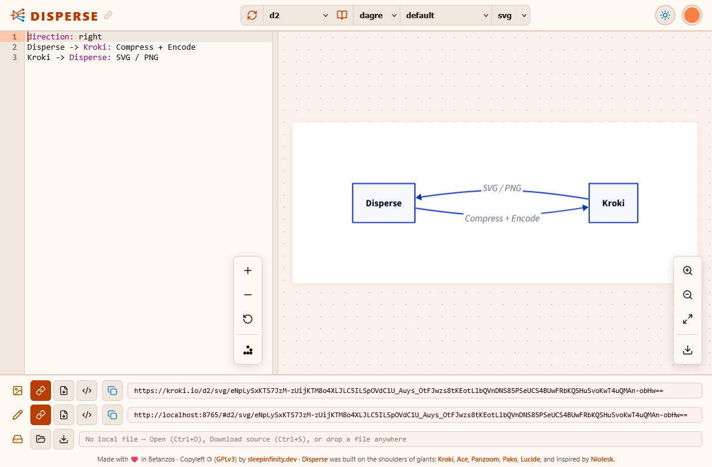
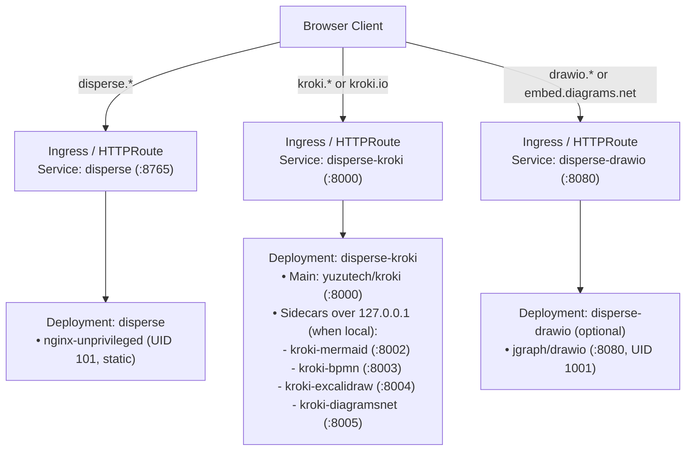

# DISPERSE

**Disperse** is a minimalist, icon-first single-page web application (**SPA**) for creating, editing, and sharing **Diagrams as Code**, powered by [Kroki](https://kroki.io) and featuring embedded interactive **Excalidraw**, **BPMN 2.0**, and **Draw.io (`diagrams.net`)** visual editors.



> [!NOTE]
> **About this project:** Disperse should be regarded as a functional prototype—personally, I believe it is the best Kroki frontend out there, though you use it at your own risk.
>
> It began as an experiment bringing together several technical curiosities: styling a web app with CSS `oklch`, exploring agentic programming, and practicing spec-driven development. At the same time, I had been planning to deploy [Niolesk](https://niolesk.top), wasn't quite convinced by its look and feel, and diagrams as code happen to be a personal obsession of mine.

---

## Documentation Map (Diátaxis)

This documentation is organized according to the [Diátaxis](https://diataxis.fr/) framework so you can jump directly to what you need:

1. [**Tutorials** *(Learning-oriented)*](#1-tutorials)
   - [Tutorial 1: Run Disperse with Docker in 60 Seconds](#tutorial-1-run-disperse-with-docker-in-60-seconds)
   - [Tutorial 2: Deploy a Self-Hosted Disperse + Kroki Stack on Local k3s with Helm](#tutorial-2-deploy-a-self-hosted-disperse--kroki-stack-on-local-k3s-with-helm)
   - [Tutorial 3: Deploy Disperse on a Traditional Web Server (Debian + Caddy, Nginx, or Apache)](#tutorial-3-deploy-disperse-on-a-traditional-web-server-debian--caddy-nginx-or-apache)
2. [**How-To Guides** *(Task-oriented)*](#2-how-to-guides)
   - [How to Choose a Deployment Topology (Remote, Full Local, or Hybrid/Mixed)](#how-to-choose-a-deployment-topology-remote-full-local-or-hybridmixed)
   - [How to Configure Companion Sidecars (`local`, `remote`, `disabled`)](#how-to-configure-companion-sidecars-local-remote-disabled)
   - [How to Deploy a Self-Hosted Draw.io Visual Editor](#how-to-deploy-a-self-hosted-drawio-visual-editor)
   - [How to Enable or Disable Diagram Engines](#how-to-enable-or-disable-diagram-engines)
   - [How to Connect to an External or Custom Kroki Server](#how-to-connect-to-an-external-or-custom-kroki-server)
   - [How to Customize or Hide Footer Credits](#how-to-customize-or-hide-footer-credits)
   - [How to Expose Disperse, Kroki, and Draw.io via Ingress or Gateway API (`HTTPRoute`)](#how-to-expose-disperse-kroki-and-drawio-via-ingress-or-gateway-api-httproute)
   - [How to Work with Local Files and Auto-Save](#how-to-work-with-local-files-and-auto-save)
3. [**Reference** *(Information-oriented)*](#3-reference)
   - [Published OCI Artifacts (`ghcr.io`)](#published-oci-artifacts-ghcrio)
   - [Published Static Web Packages (`.tar.gz`)](#published-static-web-packages-targz)
   - [12-Factor Environment Variables](#12-factor-environment-variables)
   - [Helm Chart Values (`charts/disperse`)](#helm-chart-values-chartsdisperse)
   - [Keyboard Shortcuts](#keyboard-shortcuts)
   - [Supported Diagram Engines & File Extensions](#supported-diagram-engines--file-extensions)
   - [Development Tasks (`Taskfile.yml`)](#development-tasks-taskfileyml)
4. [**Explanation** *(Understanding-oriented)*](#4-explanation)
   - [Architecture: Decoupled Static SPA & Dedicated Kroki/Draw.io Ingress/Gateway](#architecture-decoupled-static-spa--dedicated-krokidrawio-ingressgateway)
   - [Why Draw.io Has Both a Kroki Sidecar and an Optional `Deployment`](#why-drawio-has-both-a-kroki-sidecar-and-an-optional-deployment)
   - [Privacy Model: Why `local`, `remote`, and `disabled` Modes Exist](#privacy-model-why-local-remote-and-disabled-modes-exist)
   - [Stateless URLs vs. Per-Language Local Workspace Persistence](#stateless-urls-vs-per-language-local-workspace-persistence)
   - [Tetradic OKLCH Color System & Dark Mode Adaptation](#tetradic-oklch-color-system--dark-mode-adaptation)

---

## 1. Tutorials

### Tutorial 1: Run Disperse with Docker in 60 Seconds

In this tutorial, you will start Disperse in a single unprivileged container, create a diagram, customize the visual theme, and export a shareable Markdown snippet.

#### Prerequisites
- `docker` (or `podman`) installed.

#### Step 1: Start the container
Run the official OCI image from GitHub Container Registry:

```bash
docker run --rm -p 8765:8765 ghcr.io/sleepinfinitydev/disperse:latest
```

You will see:
```text
Starting server at http://localhost:8765 ...
```

#### Step 2: Create and preview a diagram
1. Open **`http://localhost:8765`** in your browser.
2. Focus is automatically placed in the code editor on the left with a default **D2** diagram rendered on the right.
3. Replace the editor text with:
   ```d2
   direction: right
   User -> Disperse: Writes code
   Disperse -> Kroki: Renders SVG
   ```
   After `500ms`, the diagram preview updates automatically and the browser URL hash updates to `#d2/svg/...`.

#### Step 3: Try a visual WYSIWYG editor
1. Open the language dropdown in the top bar (currently showing `d2`).
2. Scroll to the bottom and select **`Excalidraw (Editor · Beta)`**, **`BPMN (Editor · Beta)`**, or **`Draw.io (Editor · Beta)`**.
3. The left code panel collapses automatically to give you a full-width interactive canvas. Press **`Alt + 2`** at any time to view the live-synchronized JSON/XML code alongside the canvas.

#### Step 4: Copy a shareable snippet
In the bottom publishing bar:
- Click the **Markdown (`M↓`)** button on the first row (Image) or second row (Editor link), then click the **Copy** button on the right (or press **`Alt + I`** / **`Alt + E`**).

---

### Tutorial 2: Deploy a Self-Hosted Disperse + Kroki Stack on Local k3s with Helm

In this tutorial, you will deploy Disperse along with a complete in-cluster **Kroki** rendering stack (including Mermaid, BPMN, Excalidraw, and Diagrams.net companion sidecars) and a self-hosted **Draw.io** visual editor onto a local **[K3s](https://k3s.io)** Kubernetes cluster using the official Helm chart, exposing them via [nip.io](https://nip.io) wildcard DNS (`http://disperse.127.0.0.1.nip.io`, `http://kroki.127.0.0.1.nip.io`, and `http://drawio.127.0.0.1.nip.io`).

#### Prerequisites
- A running **[K3s](https://k3s.io)** cluster (single-node local setup is sufficient).
- `helm` v3 and `kubectl` installed.

#### Step 1: Point Helm and `kubectl` to your k3s cluster
By default, [K3s cluster access](https://docs.k3s.io/cluster-access) uses `/etc/rancher/k3s/k3s.yaml`. Export `KUBECONFIG` so both `kubectl` and `helm` communicate with your local k3s cluster:

```bash
export KUBECONFIG=/etc/rancher/k3s/k3s.yaml
kubectl get nodes
```

*(Tip: If `/etc/rancher/k3s/k3s.yaml` is only readable by root, copy it to `~/.kube/config` and `chown $(id -u):$(id -g) ~/.kube/config`.)*

#### Step 2: Create `values-k3s.yaml`
Create a concise `values-k3s.yaml` enabling the self-hosted Kroki and Draw.io backends and dedicated k3s Traefik `Ingress` resources (`disperse.127.0.0.1.nip.io`, `kroki.127.0.0.1.nip.io`, and `drawio.127.0.0.1.nip.io`):

```yaml
# values-k3s.yaml
kroki:
  enabled: true
  ingress:
    enabled: true
    hosts:
      - host: kroki.127.0.0.1.nip.io
        paths:
          - path: /
            pathType: Prefix

drawio:
  enabled: true
  ingress:
    enabled: true
    hosts:
      - host: drawio.127.0.0.1.nip.io
        paths:
          - path: /
            pathType: Prefix

ingress:
  enabled: true
  hosts:
    - host: disperse.127.0.0.1.nip.io
      paths:
        - path: /
          pathType: Prefix
```

#### Step 3: Install the Helm chart from GitHub Container Registry
Install a release named `disperse` directly from the official OCI Helm chart in GitHub Container Registry (`oci://ghcr.io/sleepinfinitydev/charts/disperse`):

```bash
helm upgrade --install disperse oci://ghcr.io/sleepinfinitydev/charts/disperse \
  --namespace disperse \
  --create-namespace \
  -f values-k3s.yaml
```

> **Testing a preview branch or building 100% locally without `ghcr.io`**:
> - **Branch preview from GHCR**: Pass `--version 0.2.0-<branch>` (automatically pulls `<branch>-<sha>`):
>   ```bash
>   helm upgrade --install disperse oci://ghcr.io/sleepinfinitydev/charts/disperse \
>     --version 0.2.0-feat-drawio-editor \
>     --namespace disperse --create-namespace -f values-k3s.yaml
>   ```
> - **Local source build on K3s (zero GHCR dependency)**: Build the image locally, import it into K3s's `containerd` store, and install `./charts/disperse` with `image.pullPolicy=Never`:
>   ```bash
>   docker build -t ghcr.io/sleepinfinitydev/disperse:0.2.0 -f Containerfile .
>   docker save ghcr.io/sleepinfinitydev/disperse:0.2.0 | sudo k3s ctr images import -
>   helm upgrade --install disperse ./charts/disperse \
>     --namespace disperse --create-namespace -f values-k3s.yaml \
>     --set image.pullPolicy=Never
>   ```

What this deploys in your k3s cluster:
- **`Deployment/disperse` + `Service/disperse` + `Ingress/disperse`**: Serves the static Disperse SPA on `http://disperse.127.0.0.1.nip.io` (`nginxinc/nginx-unprivileged`, `UID 101`, `readOnlyRootFilesystem: true`), pre-configured with `KROKI_BASE_URL=http://kroki.127.0.0.1.nip.io` and `DRAWIO_BASE_URL=http://drawio.127.0.0.1.nip.io`.
- **`Deployment/disperse-kroki` + `Service/disperse-kroki` + `Ingress/disperse-kroki`**: Runs `yuzutech/kroki` together with `kroki-mermaid`, `kroki-bpmn`, `kroki-excalidraw`, and `kroki-diagramsnet` sidecar containers (`UID 1001`, `readOnlyRootFilesystem: true`) on `http://kroki.127.0.0.1.nip.io`.
- **`Deployment/disperse-drawio` + `Service/disperse-drawio` + `Ingress/disperse-drawio`**: Runs `jgraph/drawio` (`UID 1001`, `:8080`) on `http://drawio.127.0.0.1.nip.io` for 100% private in-cluster Draw.io visual editing.

#### Step 4: Verify the rollout and run the Helm test suite
Wait for the deployments to become ready:

```bash
kubectl -n disperse rollout status deployment/disperse
kubectl -n disperse rollout status deployment/disperse-kroki
kubectl -n disperse rollout status deployment/disperse-drawio
kubectl -n disperse get pods,svc,ingress
```

Verify in-cluster service health using the chart's built-in test hook:

```bash
helm test disperse --namespace disperse
```

#### Step 5: Open Disperse in your browser
Open **`http://disperse.127.0.0.1.nip.io`** in your browser:
- All 29 diagram engines (including D2, Mermaid, PlantUML, C4, GraphViz, DBML, Excalidraw, BPMN, and Draw.io) render and edit against your private in-cluster servers (`http://kroki.127.0.0.1.nip.io` and `http://drawio.127.0.0.1.nip.io`).

---

### Tutorial 3: Deploy Disperse on a Traditional Web Server (Debian + Caddy, Nginx, or Apache)

Because Disperse is a pure HTML5/CSS3/ES6 static single-page application (**SPA**) with no server-side runtime or build step, you can deploy it directly on any traditional Linux web server **without Docker or Kubernetes**.

In this tutorial, you will download the official minimal `.tar.gz` package onto a **Debian** server (e.g., Debian 12 Bookworm / Debian 13 Trixie), optionally customize `/var/www/disperse/js/config.js`, and serve it with **Caddy**, **Nginx**, or **Apache (`apache2`)**.

#### Prerequisites
- A **Debian** host with `sudo` privileges (`tar` and `gzip` are pre-installed on Debian).
- `curl` installed:
  ```bash
  sudo apt update && sudo apt install -y curl
  ```

#### Step 1: Download, verify, and extract the static `.tar.gz` package
Download `disperse.tar.gz` and `SHA256SUMS` from GitHub Releases, verify the archive checksum, and extract the files into `/var/www/disperse`:

```bash
cd /tmp
curl -fsSLO https://github.com/sleepinfinitydev/disperse/releases/latest/download/disperse.tar.gz
curl -fsSLO https://github.com/sleepinfinitydev/disperse/releases/latest/download/SHA256SUMS
sha256sum -c --ignore-missing SHA256SUMS

sudo mkdir -p /var/www/disperse
sudo tar -xzf disperse.tar.gz -C /var/www/disperse
sudo chown -R www-data:www-data /var/www/disperse
rm -f /tmp/disperse.tar.gz /tmp/SHA256SUMS
```

> **Pinning a specific version, testing a branch preview, or packaging locally**:
> - **Pin a specific version (`v0.2.0`)**:
>   ```bash
>   curl -fsSLO https://github.com/sleepinfinitydev/disperse/releases/download/v0.2.0/disperse-0.2.0.tar.gz
>   ```
> - **Branch preview from GitHub Releases (`v0.2.0-<branch>`)**:
>   ```bash
>   curl -fsSLO https://github.com/sleepinfinitydev/disperse/releases/download/v0.2.0-feat-static-deploy/disperse-0.2.0-feat-static-deploy.tar.gz
>   ```
> - **Build the `.tar.gz` locally from source**: Run `task package` (produces `disperse-0.2.0.tar.gz` and `disperse.tar.gz`).

The extracted `/var/www/disperse` directory contains only the essential runtime assets and license (~235 KB uncompressed):
- `index.html`, `favicon.svg`, and `LICENSE` (GPLv3)
- `css/styles.css`
- `js/` (`config.js`, `theme.js`, `kroki.js`, `viewer.js`, `wysiwyg.js`, `app.js`)
- `examples/*.txt` (33 starter diagram templates)

#### Step 2: Review or customize `/var/www/disperse/js/config.js` (Optional)
Out of the box, `/var/www/disperse/js/config.js` comes pre-populated with all default settings (`https://kroki.io` and `https://embed.diagrams.net`), so **no configuration changes are required** to start using Disperse immediately.

If you want to point Disperse to a private Kroki server, a self-hosted Draw.io instance, disable specific engines, or customize the footer credits, edit `/var/www/disperse/js/config.js`:

```bash
sudo nano /var/www/disperse/js/config.js
```

```javascript
window.DISPERSE_CONFIG = Object.assign(
  {
    krokiBaseUrl: "https://kroki.io",
    krokiRemoteUrl: "https://kroki.io",
    drawioBaseUrl: "https://embed.diagrams.net",
    footerCredits:
      'Made with <i data-lucide="heart" class="heart-icon"></i> in Betanzos · ...',
    engineModes: {
      mermaid: "local",
      bpmn: "local",
      excalidraw: "local",
      diagramsnet: "local"
    },
    disabledEngines: ""
  },
  window.DISPERSE_CONFIG || {}
);
```

#### Step 3: Configure your web server on Debian (Choose Caddy, Nginx, or Apache)

Choose **one** of the following web servers (replace `disperse.example.com` with your domain, or use `:80` / `_` for local/IP access):

##### Option A: Caddy on Debian
1. Install Caddy from Debian's official repositories:
   ```bash
   sudo apt install -y caddy
   ```
2. Replace `/etc/caddy/Caddyfile` (Caddy automatically provisions HTTPS certificates when given a public domain name, or use `:80` for plain HTTP):
   ```caddyfile
   disperse.example.com {
       root * /var/www/disperse
       encode zstd gzip

       @config path /js/config.js
       header @config Cache-Control "no-store, no-cache, must-revalidate"

       file_server
   }
   ```
3. Validate and reload Caddy:
   ```bash
   sudo caddy validate --config /etc/caddy/Caddyfile
   sudo systemctl reload caddy
   ```

##### Option B: Nginx on Debian
1. Install Nginx:
   ```bash
   sudo apt install -y nginx
   ```
2. Create `/etc/nginx/sites-available/disperse`:
   ```nginx
   server {
       listen 80;
       listen [::]:80;
       server_name disperse.example.com _;

       root /var/www/disperse;
       index index.html;

       location = /js/config.js {
           default_type application/javascript;
           add_header Cache-Control "no-store, no-cache, must-revalidate";
       }

       location / {
           try_files $uri $uri/ /index.html;
       }
   }
   ```
3. Enable the site, test the configuration, and reload Nginx:
   ```bash
   sudo ln -sf /etc/nginx/sites-available/disperse /etc/nginx/sites-enabled/disperse
   sudo rm -f /etc/nginx/sites-enabled/default
   sudo nginx -t
   sudo systemctl reload nginx
   ```

##### Option C: Apache (`apache2`) on Debian
1. Install Apache and enable the `headers` and `deflate` modules:
   ```bash
   sudo apt install -y apache2
   sudo a2enmod headers deflate
   ```
2. Create `/etc/apache2/sites-available/disperse.conf`:
   ```apache
   <VirtualHost *:80>
       ServerName disperse.example.com
       DocumentRoot /var/www/disperse

       <Directory /var/www/disperse>
           Options -Indexes +FollowSymLinks
           AllowOverride None
           Require all granted
           DirectoryIndex index.html
       </Directory>

       <Location "/js/config.js">
           Header set Cache-Control "no-store, no-cache, must-revalidate"
       </Location>

       ErrorLog ${APACHE_LOG_DIR}/disperse-error.log
       CustomLog ${APACHE_LOG_DIR}/disperse-access.log combined
   </VirtualHost>
   ```
3. Enable the virtual host, disable the default placeholder site, verify syntax, and reload Apache:
   ```bash
   sudo a2ensite disperse.conf
   sudo a2dissite 000-default.conf
   sudo apache2ctl configtest
   sudo systemctl reload apache2
   ```

#### Step 4: Open Disperse in your browser
Open **`http://disperse.example.com`** (or `http://<server-ip>`) in your browser:
- Because `/js/config.js` is served with `Cache-Control: no-store, no-cache, must-revalidate`, any future edits to `/var/www/disperse/js/config.js` take effect immediately on browser refresh without restarting Caddy, Nginx, or Apache.
- To upgrade Disperse in the future while preserving your custom `js/config.js`, pass `--exclude='js/config.js'` when extracting the new archive:
  ```bash
  curl -fsSL https://github.com/sleepinfinitydev/disperse/releases/latest/download/disperse.tar.gz \
    | sudo tar -xzf - -C /var/www/disperse --exclude='js/config.js'
  sudo chown -R www-data:www-data /var/www/disperse
  ```

---

## 2. How-To Guides

### How to Choose a Deployment Topology (Remote, Full Local, or Hybrid/Mixed)

Disperse supports four deployment topologies so you can balance **cluster resource footprint** against **diagram data privacy**:

| Topology | What Runs In-Cluster | External Endpoints Used | Typical Footprint | Best For |
| :--- | :--- | :--- | :--- | :--- |
| **1. Remote Backends** *(default)* | `disperse` only (static Nginx SPA) | `https://kroki.io` + `https://embed.diagrams.net` | ~30 MB RAM | Personal setups, demos, non-confidential diagrams |
| **2. Full Local Stack** | `disperse` + `disperse-kroki` (core + 4 sidecars) + `disperse-drawio` | None for diagram data (100% in-cluster rendering & editing) | ~1.5–2.5 GB RAM | Corporate / confidential architecture & strict data privacy |
| **3. Hybrid / Mixed (Strict Private)** | `disperse` + `disperse-kroki` (core + selected sidecars `local`, others `disabled`) | None (`disabled` engines are hidden from UI) | ~600 MB–1.2 GB RAM | Private clusters conserving RAM by disabling unused editors |
| **4. Hybrid / Mixed (Public Fallback)** | `disperse` + `disperse-kroki` (core local, heavy sidecars `remote`, `drawio.enabled: false`) | `kroki.io` / `embed.diagrams.net` *(marked in UI with `🌐` warning)* | ~500–800 MB RAM | Small clusters wanting fast local core engines + transparent cloud fallback |

#### Recipe 1: Remote Backends Only (Minimal Footprint)
```yaml
# values-remote.yaml
kroki:
  enabled: false   # uses https://kroki.io
drawio:
  enabled: false   # uses https://embed.diagrams.net

ingress:
  enabled: true
  hosts:
    - host: disperse.127.0.0.1.nip.io
      paths:
        - path: /
          pathType: Prefix
```

#### Recipe 2: Full Local Stack (100% In-Cluster Rendering & Editing)
See `values-k3s.yaml` in [Tutorial 2](#tutorial-2-deploy-a-self-hosted-disperse--kroki-stack-on-local-k3s-with-helm) (`kroki.enabled: true` + `drawio.enabled: true` — all 4 Kroki sidecars default to `mode: local`).

#### Recipe 3: Hybrid / Mixed Stack (Customizing Local, Remote, and Disabled Engines)
```yaml
# values-mixed.yaml
kroki:
  enabled: true
  sidecars:
    mermaid:
      mode: local      # keep Mermaid 100% local in-cluster
    bpmn:
      mode: remote     # omit BPMN sidecar; route Kroki snippets to kroki.io with 🌐 warning
    excalidraw:
      mode: disabled   # omit Excalidraw sidecar and hide it from Disperse
    diagramsnet:
      mode: local      # keep Kroki diagramsnet rendering local
  ingress:
    enabled: true
    hosts:
      - host: kroki.127.0.0.1.nip.io
        paths:
          - path: /
            pathType: Prefix

drawio:
  enabled: false       # omit Tomcat pod; Draw.io editor uses embed.diagrams.net with 🌐 warning

disperse:
  disabledEngines:     # optionally hide any other unused code engines
    - tikz
    - bytefield

ingress:
  enabled: true
  hosts:
    - host: disperse.127.0.0.1.nip.io
      paths:
        - path: /
          pathType: Prefix
```

---

### How to Configure Companion Sidecars (`local`, `remote`, `disabled`)

When running a self-hosted Kroki backend (`kroki.enabled: true`), the core `yuzutech/kroki` container renders 25 engines natively, while **Mermaid**, **BPMN**, **Excalidraw**, and **Diagrams.net (Draw.io)** use companion headless-Chromium sidecar containers (`yuzutech/kroki-mermaid`, `yuzutech/kroki-bpmn`, `yuzutech/kroki-excalidraw`, `yuzutech/kroki-diagramsnet`).

You can control each of these 4 companion engines **individually** using three modes:

| Mode | In-Cluster Sidecar | UI Indicator in `#engine-select` | Diagram Data Privacy |
| :--- | :--- | :--- | :--- |
| **`local`** *(default)* | Deploys `yuzutech/kroki-<engine>` sidecar in `Deployment/disperse-kroki` | Standard label (e.g., `mermaid`) | 100% private / in-cluster Kroki rendering |
| **`remote`** | Not deployed (saves ~150–400 MB RAM per sidecar) | Appends **`🌐 (kroki.io)`**, highlights selector in warning color, and shows tooltip: `⚠️ External service (kroki.io, non-confidential)` | Sent to `KROKI_REMOTE_URL` (`kroki.io`) |
| **`disabled`** | Not deployed (saves RAM) | Hidden from menu (shared links show an explicit disabled notice) | 100% private (unavailable) |

*(Note: Public `https://kroki.io` does not currently run the experimental `kroki-diagramsnet` companion container; if you omit `kroki.sidecars.diagramsnet` to save RAM without a remote Kroki server that runs `kroki-diagramsnet`, set `kroki.sidecars.diagramsnet.mode: disabled`.)*

#### In Helm (`charts/disperse`)
Configure `kroki.sidecars.<engine>.mode` independently for `mermaid`, `bpmn`, `excalidraw`, and `diagramsnet`:

```yaml
# values-hybrid.yaml
kroki:
  enabled: true
  sidecars:
    mermaid:
      mode: local
    bpmn:
      mode: remote
    excalidraw:
      mode: remote
    diagramsnet:
      mode: local
```

```bash
helm upgrade --install disperse oci://ghcr.io/sleepinfinitydev/charts/disperse -n disperse -f values-hybrid.yaml
```

To save Chromium sidecar memory while guaranteeing **no diagram payload is ever sent to `kroki.io`**, set unused companion engines to `disabled`:

```yaml
# values-minimal-private.yaml
kroki:
  enabled: true
  sidecars:
    mermaid:
      mode: local
    bpmn:
      mode: disabled
    excalidraw:
      mode: disabled
    diagramsnet:
      mode: disabled
```

*(Note: Disperse's static web interface currently loads client-side UI libraries and fonts from public CDNs in the browser; disabling or localizing Kroki engines and Draw.io guarantees diagram payloads stay on-premise, while full offline/air-gapped asset vendorization is planned separately.)*

#### In Docker (`docker run`)
Pass `ENGINE_MODE_MERMAID`, `ENGINE_MODE_BPMN`, `ENGINE_MODE_EXCALIDRAW`, and `ENGINE_MODE_DIAGRAMSNET` (`local` | `remote` | `disabled`):

```bash
docker run --rm -p 8765:8765 \
  -e KROKI_BASE_URL="https://kroki.internal.example.com" \
  -e KROKI_REMOTE_URL="https://kroki.io" \
  -e ENGINE_MODE_MERMAID="local" \
  -e ENGINE_MODE_BPMN="remote" \
  -e ENGINE_MODE_EXCALIDRAW="disabled" \
  -e ENGINE_MODE_DIAGRAMSNET="local" \
  ghcr.io/sleepinfinitydev/disperse:0.2.0
```

#### On a Static Web Server (`/var/www/disperse/js/config.js`)
Edit `engineModes` in `js/config.js`:

```javascript
window.DISPERSE_CONFIG = Object.assign(
  {
    krokiBaseUrl: "https://kroki.internal.example.com",
    krokiRemoteUrl: "https://kroki.io",
    engineModes: {
      mermaid: "local",
      bpmn: "remote",
      excalidraw: "disabled",
      diagramsnet: "local"
    }
  },
  window.DISPERSE_CONFIG || {}
);
```

---

### How to Deploy a Self-Hosted Draw.io Visual Editor

By default, selecting **`Draw.io (Editor · Beta)`** embeds the official **`https://embed.diagrams.net`** visual editor via `<iframe>` + JSON `postMessage`. On self-hosted Disperse deployments, Disperse marks the selector with **`🌐 (embed.diagrams.net)`** to indicate that the visual editor UI is loaded from an external domain.

To run the Draw.io visual editor **100% privately inside your own cluster or infrastructure**:

#### Option A: Deploy `jgraph/drawio` automatically with the Helm chart
Enable `drawio.enabled: true` alongside `drawio.ingress` (or `drawio.httpRoute`). The chart automatically injects `DRAWIO_BASE_URL` into Disperse and removes the external `🌐` warning:

```yaml
# values-drawio.yaml
drawio:
  enabled: true
  ingress:
    enabled: true
    hosts:
      - host: drawio.example.com
        paths:
          - path: /
            pathType: Prefix
    tls:
      - secretName: drawio-tls
        hosts:
          - drawio.example.com
```

#### Option B: Point Disperse to an existing Draw.io server (or customize the Draw.io UI theme)
Disperse embeds Draw.io with the classic full toolbar (`?ui=kennedy`) by default, and preserves any explicit `?ui=...` query parameter (`kennedy`, `atlas`, `simple`, `min`, `sketch`) supplied in `DRAWIO_BASE_URL` / `disperse.drawioBaseUrl`:

```bash
# Docker
docker run --rm -p 8765:8765 \
  -e KROKI_BASE_URL="https://kroki.example.com" \
  -e DRAWIO_BASE_URL="https://drawio.example.com" \
  ghcr.io/sleepinfinitydev/disperse:0.2.0
```

---

### How to Enable or Disable Diagram Engines

Disperse provides two complementary controls for enabling or disabling diagram languages across all **33 selectable entries** (29 Kroki engines):

1. **Companion Sidecar Engines (`mermaid`, `bpmn`, `excalidraw`, `diagramsnet`)**:
   - **When `kroki.enabled: true` in Helm**: Set `kroki.sidecars.<engine>.mode` to `local` (default), `remote`, or `disabled`. Setting `disabled` both **prevents deploying that Chromium sidecar container** in Kubernetes and **hides the engine** from Disperse's language selector and file auto-detection.
   - **When `kroki.enabled: false` in Helm** (e.g., connecting to an external shared Kroki server that only runs a subset of sidecars): Use `disperse.engineModes` (e.g., `disperse.engineModes: { diagramsnet: "disabled", excalidraw: "remote" }`).
   - **In Docker**: Set `ENGINE_MODE_MERMAID`, `ENGINE_MODE_BPMN`, `ENGINE_MODE_EXCALIDRAW`, and `ENGINE_MODE_DIAGRAMSNET` (`local` | `remote` | `disabled`).

2. **Any Diagram Engine or C4 Variant (`KROKI_DISABLED_ENGINES` / `disperse.disabledEngines`)**:
   - You can hide **any** engine ID—including core code languages (`tikz`, `umlet`, `bytefield`, `vega`), individual C4 templates (`c4plantuml-dynamic`) or all C4 templates (`c4plantuml`), and visual editors (`excalidraw`, `bpmn`, `diagramsnet`)—without affecting other languages:

#### With Docker
```bash
docker run --rm -p 8765:8765 \
  -e KROKI_DISABLED_ENGINES="tikz,umlet,bytefield,c4plantuml-dynamic" \
  -e ENGINE_MODE_DIAGRAMSNET="disabled" \
  ghcr.io/sleepinfinitydev/disperse:0.2.0
```

#### With Helm
```yaml
# values.yaml
disperse:
  disabledEngines:
    - tikz
    - umlet
    - bytefield
    - c4plantuml-dynamic

kroki:
  enabled: true
  sidecars:
    diagramsnet:
      mode: disabled
```
```bash
helm upgrade --install disperse oci://ghcr.io/sleepinfinitydev/charts/disperse -n disperse -f values.yaml
```

#### On a Static Web Server (`/var/www/disperse/js/config.js`)
Set `disabledEngines` (comma-separated string or array) and/or `engineModes.<engine>: "disabled"` in `js/config.js`:

```javascript
window.DISPERSE_CONFIG = Object.assign(
  {
    engineModes: {
      mermaid: "local",
      bpmn: "local",
      excalidraw: "local",
      diagramsnet: "disabled"
    },
    disabledEngines: "tikz,umlet,bytefield,c4plantuml-dynamic"
  },
  window.DISPERSE_CONFIG || {}
);
```

*(Note: If a user opens a shared `#<engine>/...` URL for a language that has been disabled on the instance, Disperse preserves the URL hash, displays the decoded source code safely in the editor without overwriting local drafts, and shows an explicit notice in the preview panel.)*

---

### How to Connect to an External or Custom Kroki Server

Because Disperse's frontend is completely decoupled from the rendering backend, switching between public `https://kroki.io` and any private Kroki server is a single configuration setting (`KROKI_BASE_URL` / `disperse.krokiBaseUrl`):

```bash
# Docker
docker run --rm -p 8765:8765 \
  -e KROKI_BASE_URL="https://kroki.example.com" \
  ghcr.io/sleepinfinitydev/disperse:latest
```

```yaml
# Helm (values.yaml — using an existing Kroki server without deploying another in this release)
kroki:
  enabled: false

disperse:
  krokiBaseUrl: "https://kroki.example.com"
  # Optional: if your external Kroki server does not run certain companion sidecars:
  engineModes:
    excalidraw: remote      # fallback to kroki.io with 🌐 warning
    diagramsnet: disabled   # hide from selector
```
```bash
helm upgrade --install disperse oci://ghcr.io/sleepinfinitydev/charts/disperse -n disperse -f values.yaml
```

---

### How to Customize or Hide Footer Credits

Disperse's bottom credit line is configurable at runtime via the `FOOTER_CREDITS` environment variable (supports plain text, `<a href="...">` links, and `<i data-lucide="..."></i>` vector icons).

#### Set custom organizational credits
```bash
# Docker
docker run --rm -p 8765:8765 \
  -e FOOTER_CREDITS='Internal Architecture Portal · <a href="https://intranet.example.com" target="_blank">Platform Engineering</a>' \
  ghcr.io/sleepinfinitydev/disperse:latest
```

```yaml
# Helm (values.yaml)
disperse:
  footerCredits: 'Internal Architecture Portal · <a href="https://intranet.example.com" target="_blank">Platform Engineering</a>'
```

#### Hide the footer credit line completely
Set `FOOTER_CREDITS` / `disperse.footerCredits` to an empty string (`""`):

```bash
# Docker
docker run --rm -p 8765:8765 -e FOOTER_CREDITS="" ghcr.io/sleepinfinitydev/disperse:latest
```

```yaml
# Helm (values.yaml)
disperse:
  footerCredits: ""
```

---

### How to Expose Disperse, Kroki, and Draw.io via Ingress or Gateway API (`HTTPRoute`)

Complex diagrams produce long Base64-encoded GET URLs on the **Kroki** endpoint. While Kroki is pre-configured with `KROKI_MAX_URI_LENGTH=16384`, **make sure your Ingress or Gateway controller in front of Kroki also allows large request headers**.

#### Using Kubernetes `Ingress` (`ingress-nginx` example)
```yaml
# values-ingress.yaml
kroki:
  enabled: true
  ingress:
    enabled: true
    className: nginx
    annotations:
      nginx.ingress.kubernetes.io/large-client-header-buffers: "4 16k"
    hosts:
      - host: kroki.example.com
        paths:
          - path: /
            pathType: Prefix
    tls:
      - secretName: kroki-tls
        hosts:
          - kroki.example.com

drawio:
  enabled: true
  ingress:
    enabled: true
    className: nginx
    hosts:
      - host: drawio.example.com
        paths:
          - path: /
            pathType: Prefix
    tls:
      - secretName: drawio-tls
        hosts:
          - drawio.example.com

ingress:
  enabled: true
  className: nginx
  hosts:
    - host: disperse.example.com
      paths:
        - path: /
          pathType: Prefix
  tls:
    - secretName: disperse-tls
      hosts:
        - disperse.example.com
```
```bash
helm upgrade --install disperse oci://ghcr.io/sleepinfinitydev/charts/disperse -n disperse -f values-ingress.yaml
```

*(Note: When `disperse.krokiBaseUrl` and `disperse.drawioBaseUrl` are left empty `""`, the chart automatically derives `KROKI_BASE_URL=https://kroki.example.com` and `DRAWIO_BASE_URL=https://drawio.example.com` from `kroki.ingress` and `drawio.ingress`!)*

#### Using Kubernetes Gateway API (`HTTPRoute`)
```yaml
# values-gateway.yaml
kroki:
  enabled: true
  httpRoute:
    enabled: true
    https: true
    parentRefs:
      - name: main-gateway
        namespace: gateway-system
        sectionName: https
    hostnames:
      - kroki.example.com

drawio:
  enabled: true
  httpRoute:
    enabled: true
    https: true
    parentRefs:
      - name: main-gateway
        namespace: gateway-system
        sectionName: https
    hostnames:
      - drawio.example.com

httpRoute:
  enabled: true
  https: true
  parentRefs:
    - name: main-gateway
      namespace: gateway-system
      sectionName: https
  hostnames:
    - disperse.example.com
```
```bash
helm upgrade --install disperse oci://ghcr.io/sleepinfinitydev/charts/disperse -n disperse -f values-gateway.yaml
```

---

### How to Work with Local Files and Auto-Save

1. **Open or Drag-and-Drop**: Press **`Ctrl + O`** (or drag any diagram file onto the window). Disperse inspects the file extension and content (`.d2`, `.mmd`, `.puml`, `.dbml`, `.excalidraw`, `.bpmn`, `.drawio`, `.dio`, `.dot`, `.vg.json`, `.vl.json`, etc.) and automatically switches to the matching diagram language.
2. **Save & Save As**: Press **`Ctrl + S`** to save changes back to disk (or download the source file in browsers without the File System Access API), or **`Ctrl + Shift + S`** for Save As.
3. **Live Auto-Save to Disk**: In Chromium-based browsers (Chrome, Edge, Brave), click the lightning bolt icon (`⚡`) in the bottom local-file row or press **`Alt + A`**. Every edit in the code editor or visual WYSIWYG canvas is automatically written back to the linked local file.

---

## 3. Reference

### Published OCI Artifacts (`ghcr.io`)

Both the container image and the Helm chart are published to GitHub Container Registry under distinct paths (`disperse` vs. `charts/disperse`):

| Artifact | OCI Registry Path | `main` Tags / Versions | Branch Preview Tags / Versions (e.g. `feat-drawio-editor`) |
| :--- | :--- | :--- | :--- |
| **Container Image** | `ghcr.io/sleepinfinitydev/disperse` | `0.2.0`, `latest`, `<git-short-sha>` | `<branch>`, `<branch>-<git-short-sha>` *(never `latest`)* |
| **Helm Chart (OCI)** | `oci://ghcr.io/sleepinfinitydev/charts/disperse` | `0.2.0` *(`appVersion: 0.2.0`)* | `0.2.0-<branch>` and `0.2.0-<branch>.g<git-short-sha>` *(e.g. `0.2.0-feat-drawio-editor`, `appVersion: <branch>-<git-short-sha>`)* |

---

### Published Static Web Packages (`.tar.gz`)

Minimal static web server packages (`.tar.gz`) containing strictly the runtime files needed by **Caddy**, **Nginx**, or **Apache** (`index.html`, `favicon.svg`, `LICENSE` (GPLv3), `css/`, `js/` with pre-populated `js/config.js` defaults, and `examples/`) are built and published by `.github/workflows/static-package.yml` to both **GitHub Releases** and **GitHub Actions Artifacts**:

| Channel | Release Tag / Artifact Name | `main` Files & Direct Download URLs | Branch Preview Files (e.g. `feat-static-deploy`) |
| :--- | :--- | :--- | :--- |
| **GitHub Releases** | `v0.2.0` (`latest` on `main`)<br/>`v0.2.0-<branch>` *(prerelease)* | `disperse-0.2.0.tar.gz`, `disperse.tar.gz`, `SHA256SUMS`<br/>`https://github.com/sleepinfinitydev/disperse/releases/latest/download/disperse.tar.gz` | `disperse-0.2.0-<branch>.tar.gz`, `disperse-0.2.0-<branch>-<git-short-sha>.tar.gz`, `disperse.tar.gz`, `SHA256SUMS` *(marked `prerelease`, never `latest`)* |
| **GitHub Actions Artifacts** | `disperse-static-<version>` | `disperse-0.2.0.tar.gz`, `disperse.tar.gz`, `SHA256SUMS` *(90-day retention)* | `disperse-0.2.0-<branch>.tar.gz`, `disperse-0.2.0-<branch>-<git-short-sha>.tar.gz`, `disperse.tar.gz`, `SHA256SUMS` |

---

### 12-Factor Environment Variables

| Variable | `window.DISPERSE_CONFIG` Key | Default | Description |
| :--- | :--- | :--- | :--- |
| `PORT` | *(Nginx unprivileged)* | `8765` | HTTP listening port inside the container (`UID 101`). |
| `KROKI_BASE_URL` | `krokiBaseUrl` | `https://kroki.io` | Primary Kroki API URL used by the browser (`fetch` and shareable image snippets). |
| `KROKI_REMOTE_URL` | `krokiRemoteUrl` | `https://kroki.io` | External fallback Kroki URL used by engines in `remote` mode when `KROKI_BASE_URL` differs. |
| `DRAWIO_BASE_URL` | `drawioBaseUrl` | `https://embed.diagrams.net` | Base URL of the embedded Draw.io / `diagrams.net` visual editor (`<iframe>`; uses `ui=kennedy` by default and preserves custom `?ui=...` parameters). |
| `ENGINE_MODE_MERMAID` | `engineModes.mermaid` | `local` | Routing mode for Mermaid (`local` \| `remote` \| `disabled`). |
| `ENGINE_MODE_BPMN` | `engineModes.bpmn` | `local` | Routing mode for BPMN (`local` \| `remote` \| `disabled`). |
| `ENGINE_MODE_EXCALIDRAW` | `engineModes.excalidraw` | `local` | Routing mode for Excalidraw (`local` \| `remote` \| `disabled`). |
| `ENGINE_MODE_DIAGRAMSNET` | `engineModes.diagramsnet` | `local` | Routing mode for Diagrams.net / Draw.io (`local` \| `remote` \| `disabled`). |
| `KROKI_DISABLED_ENGINES` | `disabledEngines` | `""` | Comma-separated list of engine IDs to hide from `#engine-select`. |
| `FOOTER_CREDITS` *(alias: `DISPERSE_FOOTER_CREDITS`)* | `footerCredits` | *(Standard credits)* | Custom footer HTML/text, or `""` to hide the footer credit bar. |

---

### Helm Chart Values (`charts/disperse`)

Chart metadata: `version: 0.2.0`, `appVersion: "0.2.0"`.

| Value | Type | Default | Description |
| :--- | :--- | :--- | :--- |
| `replicaCount` | `int` | `1` | Number of Disperse frontend pods. |
| `image.registry` | `string` | `"ghcr.io"` | Disperse OCI image registry. |
| `image.repository` | `string` | `"sleepinfinitydev/disperse"` | Disperse OCI image repository. |
| `image.tag` | `string` | `""` (`"0.2.0"`) | Image tag override (defaults to `.Chart.AppVersion`). |
| `disperse.krokiBaseUrl` | `string` | `""` | Overrides primary Kroki URL (`""` auto-derives from `kroki.ingress`, `kroki.httpRoute`, `http://localhost:8000`, or `https://kroki.io`). |
| `disperse.krokiRemoteUrl` | `string` | `""` | Overrides external fallback Kroki URL (`""` defaults to `kroki.remoteFallbackUrl`). |
| `disperse.drawioBaseUrl` | `string` | `""` | Overrides Draw.io editor URL (`""` auto-derives from `drawio.ingress`, `drawio.httpRoute`, `http://localhost:8080`, or `https://embed.diagrams.net`). |
| `disperse.engineModes` | `object` | `{}` | Per-engine mode overrides (`local` \| `remote` \| `disabled`) when `kroki.enabled=false`. |
| `disperse.footerCredits` | `string\|null` | `null` | Custom footer HTML/text (`null` = default credits, `""` = hidden). |
| `disperse.disabledEngines` | `list` | `[]` | List of engine IDs to hide from `#engine-select`. |
| `service.type` | `string` | `"ClusterIP"` | Disperse Service type (`ClusterIP`, `NodePort`, `LoadBalancer`). |
| `service.port` | `int` | `8765` | Disperse Service port. |
| `ingress.enabled` | `bool` | `false` | Enables Kubernetes `Ingress` for Disperse (`disperse.127.0.0.1.nip.io`). |
| `httpRoute.enabled` | `bool` | `false` | Enables Gateway API `HTTPRoute` for Disperse. |
| `kroki.enabled` | `bool` | `false` | Deploys the self-hosted `yuzutech/kroki` Deployment and Service. |
| `kroki.service.port` | `int` | `8000` | Kroki Service port. |
| `kroki.ingress.enabled` | `bool` | `false` | Enables dedicated Kubernetes `Ingress` for Kroki (`kroki.127.0.0.1.nip.io`). |
| `kroki.httpRoute.enabled` | `bool` | `false` | Enables dedicated Gateway API `HTTPRoute` for Kroki. |
| `kroki.image.repository` | `string` | `"yuzutech/kroki"` | Kroki server image repository. |
| `kroki.image.tag` | `string` | `"0.33.0"` | Kroki server and default companion sidecar image tag. |
| `kroki.remoteFallbackUrl` | `string` | `"https://kroki.io"` | External URL used when a companion engine is set to `mode: "remote"`. |
| `kroki.maxUriLength` | `int` | `16384` | Sets `KROKI_MAX_URI_LENGTH` on the Kroki server. |
| `kroki.sidecars.shmSize` | `string` | `"256Mi"` | Shared `/dev/shm` memory limit for Chromium sidecar containers. |
| `kroki.sidecars.mermaid.mode` | `string` | `"local"` | Mermaid mode when `kroki.enabled=true` (`local` \| `remote` \| `disabled`). |
| `kroki.sidecars.bpmn.mode` | `string` | `"local"` | BPMN mode when `kroki.enabled=true` (`local` \| `remote` \| `disabled`). |
| `kroki.sidecars.excalidraw.mode` | `string` | `"local"` | Excalidraw mode when `kroki.enabled=true` (`local` \| `remote` \| `disabled`). |
| `kroki.sidecars.diagramsnet.mode` | `string` | `"local"` | Diagrams.net mode when `kroki.enabled=true` (`local` \| `remote` \| `disabled`). |
| `drawio.enabled` | `bool` | `false` | Deploys the self-hosted `jgraph/drawio` visual editor Deployment and Service. |
| `drawio.service.port` | `int` | `8080` | Draw.io Service port. |
| `drawio.ingress.enabled` | `bool` | `false` | Enables dedicated Kubernetes `Ingress` for Draw.io (`drawio.127.0.0.1.nip.io`). |
| `drawio.httpRoute.enabled` | `bool` | `false` | Enables dedicated Gateway API `HTTPRoute` for Draw.io. |
| `drawio.image.repository` | `string` | `"jgraph/drawio"` | Draw.io visual editor image repository. |
| `drawio.image.tag` | `string` | `"32.6.10"` | Draw.io visual editor image tag. |
| `drawio.remoteFallbackUrl` | `string` | `"https://embed.diagrams.net"` | External Draw.io embed URL used when `drawio.enabled=false`. |
| `pdb.enabled` | `bool` | `false` | Enables `PodDisruptionBudget` (`policy/v1`, defaults to `maxUnavailable: 1`). |
| `extraManifests` | `list` | `[]` | Arbitrary Kubernetes manifests rendered through Helm's `tpl` engine. |

---

### Keyboard Shortcuts

| Shortcut | Action |
| :--- | :--- |
| `Ctrl/Cmd + R` | Refresh diagram preview immediately |
| `Alt + R` | Toggle automatic preview rendering (`500ms` debounce) |
| `Alt + N` | New diagram / Reset active language to default example |
| `Ctrl/Cmd + O` | Open local file |
| `Ctrl/Cmd + S` | Save local file (or download source file) |
| `Ctrl/Cmd + Shift + S` | Save local file as... |
| `Alt + A` | Toggle local file auto-save |
| `Alt + T` | Toggle Light / Dark theme |
| `F11` | Toggle browser fullscreen |
| `Alt + V` | Toggle Vim keybindings in the code editor |
| `Alt + L` | Copy current page link to clipboard |
| `Alt + 1` | Maximize code editor panel (`100%`) |
| `Alt + 2` | Reset split to golden ratio (`38.2%` / `61.8%`) |
| `Alt + 3` | Maximize diagram preview panel (`100%`) |
| `Alt + Enter` | Maximize / Restore diagram preview (also collapses export rows) |
| `Alt + +` / `Alt + -` / `Alt + 0` | Zoom in / Zoom out / Fit diagram preview |
| `Alt + D` | Download rendered diagram (`.svg` or `.png`) |
| `Alt + Shift + +` / `-` / `0` | Increase / Decrease / Reset code editor font size |
| `Alt + I` / `Alt + E` | Copy Image snippet / Copy Editor snippet |
| `Alt + X` | Collapse / Restore bottom export section |

---

### Supported Diagram Engines & File Extensions

| Category | Engine ID | Label in UI | Default File Ext |
| :--- | :--- | :--- | :--- |
| **Featured** | `d2` | `d2` *(default)* | `.d2` |
| **Featured** | `mermaid` | `mermaid` | `.mmd`, `.mermaid` |
| **Featured** | `dbml` | `dbml` | `.dbml` |
| **Featured (C4)** | `c4plantuml-context`, `-container`, `-component`, `-dynamic`, `-deployment` | `c4plantuml (...)` | `.puml`, `.plantuml` |
| **Code Engines** | `actdiag`, `blockdiag`, `nwdiag`, `packetdiag`, `rackdiag`, `seqdiag` | `actdiag`, `blockdiag`, ... | `.txt` |
| **Code Engines** | `bytefield` | `bytefield` | `.clj`, `.edn` |
| **Code Engines** | `ditaa` | `ditaa` | `.ditaa` |
| **Code Engines** | `erd` | `erd` | `.erd` |
| **Code Engines** | `graphviz` | `graphviz` | `.dot`, `.gv` |
| **Code Engines** | `nomnoml` | `nomnoml` | `.nomnoml` |
| **Code Engines** | `pikchr` | `pikchr` | `.pikchr` |
| **Code Engines** | `plantuml` | `plantuml` | `.puml`, `.plantuml`, `.iuml` |
| **Code Engines** | `structurizr` | `structurizr` | `.dsl` |
| **Code Engines** | `svgbob` | `svgbob` | `.txt` |
| **Code Engines** | `symbolator` | `symbolator` | `.vhd`, `.vhdl`, `.v`, `.sv` |
| **Code Engines** | `tikz` | `tikz` | `.tex`, `.tikz` |
| **Code Engines** | `umlet` | `umlet` | `.uxf` |
| **Code Engines** | `vega` / `vegalite` | `vega` / `vegalite` | `.vg.json` / `.vl.json` |
| **Code Engines** | `wavedrom` | `wavedrom` | `.json` |
| **Code Engines** | `wireviz` | `wireviz` | `.yml`, `.yaml` |
| **Visual Editors (Beta)** | `excalidraw` | `Excalidraw (Editor · Beta)` | `.excalidraw` |
| **Visual Editors (Beta)** | `bpmn` | `BPMN (Editor · Beta)` | `.bpmn` |
| **Visual Editors (Beta)** | `diagramsnet` | `Draw.io (Editor · Beta)` | `.drawio`, `.dio`, `.drawio.xml` |

---

### Development Tasks (`Taskfile.yml`)

```bash
# Run locally on http://localhost:8765 (supports 12-Factor env vars)
task run
ENGINE_MODE_EXCALIDRAW=remote KROKI_BASE_URL=http://localhost:8000 task run PORT=9000
DRAWIO_BASE_URL=http://localhost:8080 task run
FOOTER_CREDITS="" task run

# Package minimal static .tar.gz archives (disperse-0.2.0.tar.gz and disperse.tar.gz) for Caddy/Nginx/Apache
task package

# Build OCI image (auto-detects podman or docker, tags :0.2.0, :<git-hash>, and :latest)
task build

# Build and push OCI image to registry
task push
```

---

## 4. Explanation

### Architecture: Decoupled Static SPA & Dedicated Kroki/Draw.io Ingress/Gateway

Disperse, Kroki, and Draw.io have fundamentally different runtime profiles: Disperse is an ultra-lightweight static HTML/CSS/JS SPA, Kroki is a JVM/CLI + headless-Chromium rendering backend that expects requests at its root path (`/{engine}/{format}/{payload}`) and natively emits CORS headers (`Access-Control-Allow-Origin: *`), and Draw.io (`jgraph/drawio`) is a Tomcat webapp embedded via `<iframe>` + `postMessage`.

Instead of coupling Disperse's Nginx container as a reverse proxy in front of Kroki or Draw.io, the Helm chart exposes **each service cleanly through its own Kubernetes `Service` and `Ingress` / Gateway API `HTTPRoute`**:



- **100% Controller-Agnostic**: Works out of the box on K3s (Traefik), `ingress-nginx`, Cilium, HAProxy, AWS ALB, and any Gateway API controller without vendor-specific regex path-rewrite annotations or CRDs.
- **Zero Extra Network Hops**: Diagram rendering and visual editor requests go directly to `disperse-kroki` / `disperse-drawio` (or `kroki.io` / `embed.diagrams.net`), never traversing the frontend Nginx pod.
- **Pure 12-Factor & Restricted PodSecurity**: All Deployments run non-root (`UID 101` and `UID 1001`) with `allowPrivilegeEscalation: false`, `seccompProfile: RuntimeDefault`, and `capabilities.drop: ["ALL"]`, configured strictly via environment variables.

---

### Why Draw.io Has Both a Kroki Sidecar and an Optional `Deployment`

Unlike **Excalidraw** (`@excalidraw/excalidraw`) and **BPMN** (`bpmn-js`), which are client-side JavaScript libraries mounted directly into a `<div>` inside Disperse, **Draw.io (`diagrams.net`)** is a full web application designed to be embedded via **`<iframe>` + JSON `postMessage`**. Consequently, full self-hosted Draw.io support involves two distinct components with separate roles and network boundaries:

| Component | Role | Who Communicates With It |
| :--- | :--- | :--- |
| **`kroki-diagramsnet` sidecar** *(inside `Deployment/disperse-kroki`, `:8005`)* | Headless Node.js + Chromium worker bundling only `export3.html` (**no interactive editor UI**). Converts `<mxfile>` XML into static `SVG` / `PNG`. | Only the **`kroki`** container over `127.0.0.1:8005` (never exposed externally). Powers shareable Kroki image URLs (`/diagramsnet/svg/...`). |
| **`Deployment/disperse-drawio`** *(`jgraph/drawio`, `:8080`, when `drawio.enabled: true`)* | Complete interactive Draw.io web editor (Tomcat + UI, menus, stencils, shapes). | Directly the **user's browser** via `Ingress` / `HTTPRoute` inside Disperse's `<iframe src=".../?embed=1">`, replacing `https://embed.diagrams.net`. |

Keeping `disperse-drawio` as an independent optional `Deployment` lets you expose it cleanly to the browser, scale or omit it independently from Kroki, and preserve `readOnlyRootFilesystem: true` on `disperse` and `disperse-kroki`.

---

### Privacy Model: Why `local`, `remote`, and `disabled` Modes Exist

While `yuzutech/kroki` includes 25 diagram engines in a single container, **Mermaid**, **BPMN**, **Excalidraw**, and **Diagrams.net** rely on browser layout APIs and run as companion headless-Chromium sidecar containers.

By default (`mode: "local"`), deploying Kroki via the Helm chart (`kroki.enabled: true`) launches all four sidecars inside the `disperse-kroki` Pod over `127.0.0.1` for complete on-premise rendering privacy, and enabling `drawio.enabled: true` hosts the interactive Draw.io visual editor inside the cluster as well. For smaller clusters that wish to conserve memory, Disperse's tri-state engine model (`local` | `remote` | `disabled`) makes any external dependency **explicit and transparent to end users**:
- Setting an engine to **`remote`** (or leaving `drawio.enabled: false` so Draw.io uses `embed.diagrams.net` on a self-hosted instance) visibly marks it in `#engine-select` with **`🌐 (<host>)`**, `--color-tertiary` warning styling, and a **`⚠️ External service (<host>, non-confidential)`** tooltip.
- Setting an engine to **`disabled`** omits its sidecar container and removes the engine from `#engine-select` completely.

---

### Stateless URLs vs. Per-Language Local Workspace Persistence

Disperse combines two complementary state models:
1. **Stateless Kroki-Compatible URLs**: Every change compresses the diagram source using **Zlib deflate (level 9)** + **URL-safe Base64** into `#engine/format/payload`, making every URL self-contained.
2. **Per-Language `localStorage` Drafts**: Each of the 33 selectable entries in `#engine-select` saves its own independent draft (`disperse-draft:{engine}`) in the browser. Switching from D2 to Mermaid, Excalidraw, BPMN, or Draw.io switches cleanly to that language's workspace without syntax collisions. Opening someone else's shared `#hash` link displays their diagram immediately **without overwriting** your saved local draft unless you edit it.

---

### Tetradic OKLCH Color System & Dark Mode Adaptation

From a single user-selected preferred color (`#0080c0` by default), Disperse converts `sRGB → Oklab → OKLCH` in real time to compute a **30° double-complementary tetradic palette** ($H$, $H+30^\circ$, $H+180^\circ$, $H+210^\circ$). In Dark Mode, rendered SVG/PNG diagrams use `filter: invert(0.92) hue-rotate(180deg)` so black strokes and text become crisp and bright against dark surfaces while preserving the original semantic hues of colored diagram nodes.

---

## Acknowledgments

Built on the shoulders of giants: [Kroki](https://kroki.io) (MIT), [Excalidraw](https://excalidraw.com) (MIT), [bpmn.io / bpmn-js](https://bpmn.io) (bpmn.io License), [diagrams.net / draw.io](https://www.diagrams.net) (Apache-2.0), [Ace Editor](https://ace.c9.io) (BSD-3-Clause), [Panzoom](https://github.com/timmywil/panzoom) (MIT), [Pako](https://github.com/nodeca/pako) (MIT/Zlib), [Lucide](https://lucide.dev) (ISC/MIT), and inspired by [Niolesk](https://niolesk.top) (MIT).

## License

Licensed under the [GNU General Public License v3.0 (GPLv3)](LICENSE).
